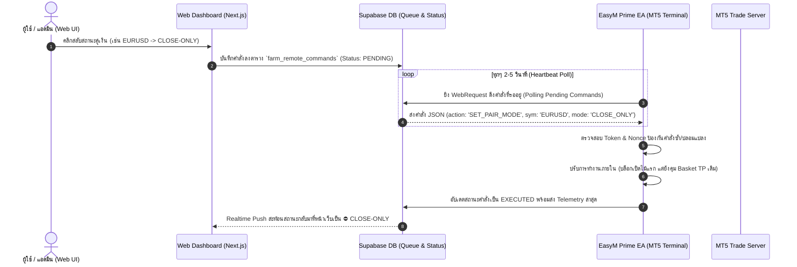
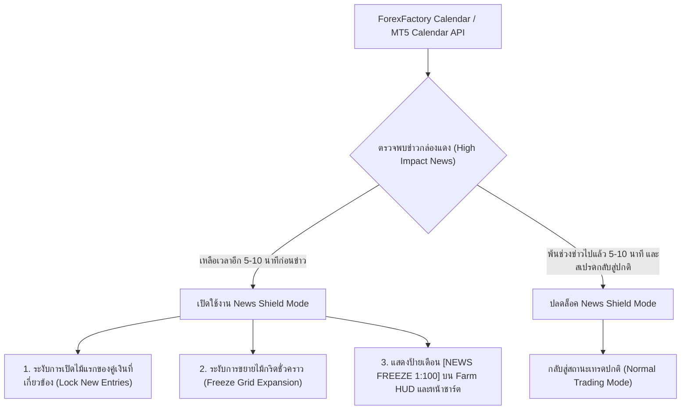

# 🚀 แผนพัฒนา EasyM PRIME (เฟส 2): Two-Way Command & News Leverage Shield

> **เอกสารบันทึกแผนงานและสถาปัตยกรรมทางเทคนิค (Phase 2 Technical Roadmap & Architecture Specification)**  
> **เป้าหมาย:** สรุปฟังก์ชันหลักสำหรับพัฒนา EasyM Prime เวอร์ชันถัดไป (v2.10+) เพื่อเป็นคู่มือและข้อกำหนดเตือนความจำเมื่อเริ่มลงมือเขียนโค้ด  
> **วันที่มีผลบันทึก:** 15 ตุลาคม 2026  
> **สถานะ:** บันทึกข้อกำหนดและพร้อมนำไปปฏิบัติการในรอบพัฒนาเฟส 2

---

## 📌 สรุปภาพรวมของเฟส 2 (Executive Summary)

ใน EasyM Prime เฟสแรก เราได้ทำการวางโครงสร้างหน้าฟาร์มแบบใหม่ (กระดาน 20 คู่เงิน, โดมกักขังและฟื้นฟู, ปรอทวัด Drawdown, และระบบ Telemetry ถ่ายทอดสด) ซึ่งแสดงผลแบบ Read-Only และควบคุมการเผยแพร่ด้วยระบบ Release Gate ให้ลูกค้าเรียบร้อยแล้ว

ใน **เฟสที่ 2** จะเป็นการยกระดับตัว EA (ฝั่ง MQL5) และระบบคลาวด์หลังบ้าน (Next.js / Supabase API) ให้ทำงานสอดประสานกันอย่างสมบูรณ์แบบ โดยมี **2 เสาหลักสำคัญ** ได้แก่:
1. **ระบบการสื่อสารสองทาง (Two-Way Interactive Remote Control):** สั่งเปิด-ปิดคู่เงิน (Active vs Close-Only) หรือสั่งหยุดฉุกเฉินได้โดยตรงจากหน้าเว็บฟาร์ม
2. **ระบบป้องกันข่าวกล่องแดงและการปรับลด Leverage ของโบรกเกอร์ (News Filter & Leverage Drop Shield):** ป้องกันความเสี่ยงจากการที่โบรกเกอร์ (เช่น FISG) ปรับลด Leverage เหลือ 1:100 ช่วงข่าวแรง จนส่งผลให้มาร์จิ้นไม่พอออกไม้แก้ (`Order Rejected`) หรือโดน Stop Out

---

## 🛰️ เสาหลักที่ 1: ระบบการสื่อสารสองทาง (Two-Way Remote Command)

### 1.1 วัตถุประสงค์และการทำงาน
อนุญาตให้ผู้ใช้/แอดมินสามารถคลิกสั่งการคู่เงินแต่ละคู่บนหน้าเว็บฟาร์ม (เช่น ลูกแก้วที่ 2 หรือ Cockpit Matrix) แล้วคำสั่งเดินทางไปถึง EA บน MT5 ในเครื่องลูกข่ายได้อย่างปลอดภัยและเสถียร

### 1.2 คำสั่งที่รองรับในระบบสองทาง
1. **`SET_PAIR_MODE` (ควบคุมรายคู่เงิน):**
   * `ACTIVE`: เปิดรับสัญญาณเทรดและเข้าออเดอร์ปกติ
   * `CLOSE-ONLY`: ไม่เปิดไม้แรกของรอบใหม่ แต่ปล่อยให้ไม้ที่ค้างอยู่เคลียร์ตัวเองจนชน Take Profit เมื่อออเดอร์หมดจะไม่เข้าเทรดคู่นั้นอีก
2. **`PAUSE_ALL_NEW` (หยุดเปิดคู่ใหม่ทั้งหมด):** สลับทุกคู่เป็น Close-Only ทันทีเมื่อสภาวะตลาดผันผวน
3. **`RESUME_ALL` (คืนค่าการทำงานทั้งหมด):** ปลดล็อคให้ทุกคู่เงินกลับมา Active ตามค่า Settings เดิม
4. **`EMERGENCY_LOCK_PAIR` (สั่งกักขังฉุกเฉิน):** ย้ายคู่เงินเข้าสู่โซน Quarantine ทันทีด้วยตนเอง

### 1.3 กลไกความปลอดภัยและความต่อเนื่องของสัญญาณ (Fail-Safe)
* **Watchdog Fallback:** หากเกิดเหตุอินเทอร์เน็ตขาดหาย หรือ MT5 ไม่สามารถเชื่อมต่อ API เว็บไซต์ได้เกิน 60 วินาที EA จะรักษาโหมดความปลอดภัยล่าสุดไว้ และจะไม่อนุญาตให้คำสั่งเก่าที่ค้างส่งผลย้อนหลัง (Discard commands older than 3 minutes)
* **Single Authority:** การตัดสินใจเปิดไม้แก้ (Martingale / Rescue Grid) ยังคงรันบนตรรกะภายในเครื่อง MT5 เป็นหลัก เพื่อป้องกันความหน่วง (Latency) ของอินเทอร์เน็ต

---

## 🛡️ เสาหลักที่ 2: ระบบเกราะป้องกันข่าวและ Leverage (News & Leverage Shield)

### 2.1 ปัญหาและที่มา (Case Study: โบรกเกอร์ FISG)
* **นโยบายโบรกเกอร์:** โบรกเกอร์ FISG ปรับลด Leverage สำหรับ Forex และทองคำเหลือ **1:100** ในช่วงข่าวกล่องแดง (ForexFactory Red Folder) ตั้งแต่ **4 นาทีก่อนข่าว จนถึง 1 นาทีหลังข่าว**
* **ความเสี่ยงต่อระบบ Grid / Martingale:**
  * ออเดอร์ใหม่ที่เปิดช่วง 5 นาทีนี้ ต้องใช้เงินวางมาร์จิ้นสูงขึ้น **5 ถึง 10 เท่า** (จาก 1:500 หรือ 1:1000)
  * หากกราฟกระชากแรงแล้ว EA มีเงื่อนไขต้องเข้าเปิดไม้แก้ (Averaging / Rescue) มาร์จิ้นจะไม่พอ ส่งผลให้ MT5 ปฏิเสธคำสั่ง (`10019: TRADE_RETCODE_NO_MONEY`)
  * สเปรดที่ถ่างกว้าง (Spread Widening) ในช่วงข่าวจะยิ่งกดให้ Floating Drawdown ลึกขึ้นชั่วคราว เสี่ยงต่อการโดนบังคับปิดพอร์ต (Stop Out)

### 2.2 ข้อกำหนดฟังก์ชันสำหรับตัว EA (MQL5 Implementation Spec)
1. **ระบบอ่านปฏิทินข่าว (News Calendar Provider):**
   * **ทางเลือก A (Built-in Calendar):** ใช้ฟังก์ชันมาตรฐาน `CalendarValueHistory()` ใน MQL5 ดึงข้อมูลข่าวระดับ High Impact (Importance == 3) โดยตรงจาก Server ของ MT5 ไม่ต้องพึ่งพา WebRequest ภายนอก
   * **ทางเลือก B (Cloud News Sync API):** ฝั่ง Server Web ดึงปฏิทิน ForexFactory แล้วส่งตารางข่าวประจำวันแนบไปกับ Heartbeat Telemetry ให้ EA อ่านแบบเบาเครื่อง
2. **การตั้งค่าพารามิเตอร์ของ EA (EA Input Parameters):**
   * `InpNewsFilterEnabled` = `true` (เปิด/ปิดระบบกรองข่าว)
   * `InpNewsImportance` = `HIGH_IMPACT_ONLY` (เฉพาะข่าวกล่องแดง)
   * `InpMinsBeforeNews` = `10` (หยุดเปิดไม้ใหม่ก่อนข่าว 10 นาที — ครอบคลุมกฎ 4 นาทีของโบรกเกอร์อย่างปลอดภัย)
   * `InpMinsAfterNews` = `10` (รอให้สเปรดหดกลับสู่ปกติหลังข่าว 10 นาที — ครอบคลุมกฎ 1 นาทีของโบรกเกอร์)
   * `InpMaxAllowedSpread` = `35` (ตรวจสอบสเปรด หากสเปรดยังถ่างเกินกำหนดจะไม่เปิดไม้เด็ดขาด)
3. **การจับคู่สกุลเงินของข่าว (Currency Matching Engine):**
   * ข่าวของสกุลเงินใด จะหยุดการออกไม้เฉพาะคู่เงินที่มีสกุลนั้นประกอบอยู่เท่านั้น เช่น:
     * ข่าว **USD** (Non-Farm, CPI, FOMC) -> สั่งหยุดเฉพาะคู่ที่มี USD (`EURUSD`, `GBPUSD`, `USDJPY`, ฯลฯ)
     * คู่เงินที่ไม่เกี่ยวกับข่าว เช่น `EURJPY`, `AUDCAD` สามารถทำงานต่อไปได้ตามปกติ ช่วยให้ไม่เสียโอกาสทำกำไร

---

## 🖥️ เสาหลักที่ 3: การแสดงผลบน Web Dashboard & Farm HUD

### 3.1 การแสดงผลบนกระดาน 20 คู่เงิน (Orb 2 Matrix)
* **ป้ายสถานะข่าว (News Badge):** หากคู่เงินใดกำลังอยู่ในช่วง News Shield จะแสดงป้ายกะพริบสีส้ม `📰 NEWS (1:100)` และมีเวลานับถอยหลัง (Countdown Timer) เช่น `RESUME IN 07:42`
* **ปุ่มควบคุม 2 ทิศทาง:** เมื่อสลับโหมดเป็นเวอร์ชัน 2 ปุ่ม `ACTIVE` และ `CLOSE-ONLY` จะสามารถกดเพื่อส่งคำสั่งได้จริง พร้อมแสดงสถานะ `Syncing...` และ `Confirmed`

### 3.2 การรักษาความปลอดภัยด้านการพัฒนา (Development Guard)
* **Feature Gating (`isOwnerDevUser`):** ในระหว่างที่เขียนโค้ดเฟส 2 ฟังก์ชันส่งคำสั่งและตัวกรองข่าวจะเปิดให้ทดสอบเฉพาะใน **โหมดพัฒนา (Dev)** ของเจ้าของระบบเท่านั้น
* **Customer Protection:** ลูกค้าทั่วไปจะยังคงมองเห็นหน้าฟาร์มเป็นเวอร์ชันนิ่งที่เสถียร (Display-Only) จนกว่าเจ้าของระบบจะทดสอบจนสมบูรณ์และกดปุ่ม **"อัปเดตปล่อยหน้าฟาร์มนี้ให้ลูกค้า"** ผ่านระบบ Release Gate อีกครั้ง

---

## 📊 เสาหลักที่ 4: การปรับแต่งแดชบอร์ดบนกราฟ MT5 (MT5 On-Chart HUD Upgrade)

### 4.1 ปรับมาตรฐานชื่อ EA บน Table C (Unified Branding)
* **ปัญหาเดิม:** บนแถบสถานะพอร์ต Table C ยังมีคำว่า `Universal` ปรากฏอยู่ เช่น `=== EasyM Prime Universal v2.00 1014 [B261014.1] ===` ซึ่งไม่ตรงกับชื่อเรียกอย่างเป็นทางการบนหน้าเว็บฟาร์มและระบบไลเซนส์
* **ข้อกำหนดใหม่:**
  * **ตัดคำว่า `Universal` ออกทั้งหมด** เพื่อให้ชื่อผลิตภัณฑ์เป็นเอกภาพ (Unified Name) ทั่วทั้งระบบ
  * รูปแบบมาตรฐานที่กำหนด: `EasyM Prime v2.00 [BuildID]` (เช่น `EasyM Prime v2.00 [B261014.1]` หรือ `EasyM Prime v2.00 1014 [B261014.1]`)
  * ปรับค่าคงที่ `#define EA_DASH_TITLE` และ `#property description` ในไฟล์โค้ด MQL5 ให้ตรงตามมาตรฐานนี้

### 4.2 เพิ่ม Table F: แถบแจ้งเตือนสถานะแยกเดี่ยวเต็มแถว (Dedicated Full-Width Alert Row)
* **ปัญหาเดิม:** ข้อมูลแจ้งเตือน (Alert / Quarantine Status / Rescue Info) ถูกยัดรวมไว้ใน Table E ช่องที่ 3 (`Col 2`) ร่วมกับค่า Buffer และ Relief Fund ทำให้พื้นที่จำกัด ข้อความยาวถูกตัดทอน หรือเบียดเสียดจนมองเห็นได้ไม่ชัดเจน
* **โครงสร้างและตำแหน่ง Table F:**
  * ตำแหน่ง: วางต่อจาก Table E ลงมาด้านล่างสุดของแผงแดชบอร์ด (`ey0 + rowH + pad`)
  * มิติ: ความยาวเต็มความกว้างของแผงแดชบอร์ด 100% (`dW`) ความสูง 1 แถวมาตรฐาน (`rowH`)
  * ลักษณะกรอบ: สไตล์แถบ Sci-Fi HUD แบบกล่องข้อความเต็มแถวเดี่ยว ไม่มีเส้นคอลัมน์กั้นกลาง เพื่อให้อ่านข้อความยาวได้ต่อเนื่อง
* **ระบบจัดลำดับความสำคัญของข้อความแจ้งเตือน (Alert Message Hierarchy):**
  ข้อความใน Table F จะแสดงผลตามลำดับความสำคัญสูงสุด (Priority Queue) ดังนี้:
  1. 🚨 **ระดับวิกฤต (Critical - สีแดง):** มาร์จิ้นต่ำ หรือเสี่ยงโดน Stop Out เช่น `[CRITICAL: MARGIN LEVEL < 150% - SUSPENDING ENTRIES]`
  2. 📰 **ระดับข่าวสารและการป้องกัน (News & Shield - สีทอง/ส้ม):** เมื่อระบบป้องกันข่าวทำงาน เช่น `[NEWS SHIELD: USD HIGH IMPACT IN 08:32 - 1:100 LEVERAGE GUARD]`
  3. 🛡️ **ระดับการกักขังและกู้ชีพ (Quarantine & Rescue - สีฟ้า/ทอง):** แจ้งเตือนคู่เงินที่ถูกขังหรือกำลังใช้ไม้กู้ชีพ เช่น `[QUARANTINE: EURUSD HEDGED | RESCUE R2 ACTIVE (DD: 2.15%)]`
  4. ⛔ **ระดับการสั่งการจากระยะไกล (Remote Mode - สีส้ม):** แจ้งเตือนเมื่อมีคู่เงินถูกตั้งเป็น Close-Only จากหน้าเว็บ เช่น `[REMOTE: 2 PAIRS SET TO CLOSE-ONLY BY DASHBOARD]`
  5. 🟢 **ระดับปกติ (Healthy - สีเขียว):** ระบบทำงานราบรื่น เช่น `[SYSTEM HEALTHY - ALL 20 SYSTEMS NOMINAL | CPU OK]`

---

## 📋 แผนงานและขั้นตอนการลงมือพัฒนา (Implementation Checklist)

- [ ] **ขั้นตอนที่ 1: ฝั่ง Database & API**
  - [ ] สร้างตาราง `farm_remote_commands` ใน Supabase (รองรับ `port_number`, `command_type`, `payload`, `status`, `created_at`, `executed_at`)
  - [ ] สร้าง API Route `/api/farm/command/send` สำหรับรับคำสั่งจากเว็บ
  - [ ] สร้าง API Route `/api/farm/command/poll` สำหรับให้ EA ดึงคำสั่งไปรัน
- [ ] **ขั้นตอนที่ 2: ฝั่ง EA (MQL5 Prime Codebase)**
  - [ ] ปรับชื่อใน `#define EA_DASH_TITLE` และ `#property description` เป็น `EasyM Prime v2.00 [BuildID]` (ตัดคำว่า Universal ออก)
  - [ ] เพิ่มโครงสร้าง **Table F** ในฟังก์ชัน `DashboardBuild()` (สร้าง Rect กรอบเดี่ยวเต็มความกว้าง `dW` และ Text Object `F_MSG`)
  - [ ] ย้ายข้อความแจ้งเตือนจาก Table E Col 2 มาแสดงผลใน Table F แบบเต็มแถวใน `DashboardUpdate()` พร้อมระบบแสดงสีตาม Priority
  - [ ] เพิ่มฟังก์ชันประมวลผลคำสั่งระยะไกล `ProcessRemoteWebCommands()`
  - [ ] เพิ่มโมดูลตรวจสอบข่าว `NewsFilterModule.mqh` (อ่านค่าข่าวและสกุลเงินที่ได้รับผลกระทบ)
  - [ ] ตรวจสอบ Leverage และ Margin ก่อนส่ง OrderSend ทุกครั้ง หากพบว่า Leverage ถูกลดเหลือ 1:100 และเงินไม่พอ ให้เข้าโหมด Safe Delay
- [ ] **ขั้นตอนที่ 3: ฝั่ง Frontend (Farm Client & Dev Dock)**
  - [ ] เปิดสวิตช์ปุ่ม interactive ใน Orb 2 ให้ส่งคำสั่งเข้า API เมื่ออยู่ในโหมด Dev
  - [ ] เพิ่ม News Indicator แสดงไอคอนข่าวกล่องแดงบนคู่เงินในหน้าฟาร์ม
  - [ ] ทดสอบการทำงาน End-to-End บนพอร์ตทดสอบของเจ้าของระบบ
- [ ] **ขั้นตอนที่ 4: ปล่อยใช้งานจริง (Production Deployment)**
  - [ ] ตรวจสอบความถูกต้องของแดชบอร์ดบนกราฟ MT5 (Table C ชื่อตรง, Table F แสดงข้อความแจ้งเตือนชัดเจน)
  - [ ] ประกาศอัปเดต EasyM Prime v2.10 ให้ลูกค้าดาวน์โหลดไฟล์ `.ex5` ใหม่
  - [ ] ปลดล็อคระบบ Two-Way สู่โหมดสาธารณะผ่าน Dev Controller

---
*บันทึกโดย: Antigravity AI Pair Programmer & System Architect*  
*ไฟล์อ้างอิงหลัก: `docs/EASYM_PRIME_PHASE2_ROADMAP.md`*

