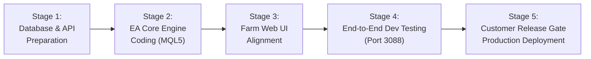

# 📑 Prime Phase 2 Development Plan (OCT26): EA Core & Web Alignment Matrix

> **ชื่อเอกสาร:** Prime Phase 2 Development Plan (OCT26)  
> **แนวคิดหลัก (Core Philosophy):** **"EA-First Architecture"** — ยึดถือฟังก์ชันและความเสถียรของตัว EA ในโปรแกรม MT5 เป็นแกนหลัก แล้วพัฒนาส่วนของ Web Dashboard / Cloud API ให้สอดรับและขยายขีดความสามารถของ EA อย่างกลมกลืน  
> **รอบการพัฒนา:** ตุลาคม 2026 (OCT26)  
> **เป้าหมายเวอร์ชัน:** EasyM Prime v2.10+ & Next.js Farm Cockpit v2.10  
> **สถานะ:** แผนแม่บทสถาปัตยกรรมระบบ (Master Architectural Blueprint) พร้อมนำไปปฏิบัติงาน  

---

## 📌 สารบัญ (Table of Contents)
1. [ภาพรวมของแผนงาน (Executive Overview)](#1-ภาพรวมของแผนงาน-executive-overview)
2. [5 เสาหลักทางเทคนิคฝั่ง EA (Core EA Engine Specification)](#2-5-เสาหลักทางเทคนิคฝั่ง-ea-core-ea-engine-specification)
3. [ตารางความสอดคล้องฝั่งหน้าเว็บ (Web Alignment Matrix by EA Feature)](#3-ตารางความสอดคล้องฝั่งหน้าเว็บ-web-alignment-matrix-by-ea-feature)
4. [รายละเอียดการพัฒนาหน้าเว็บที่สอดคล้องกับ EA (Web UI Implementation Details)](#4-รายละเอียดการพัฒนาหน้าเว็บที่สอดคล้องกับ-ea-web-ui-implementation-details)
5. [ข้อกำหนดสัญญาการสื่อสารข้อมูล (Data Contract & API Protocols)](#5-ข้อกำหนดสัญญาการสื่อสารข้อมูล-data-contract--api-protocols)
6. [ลำดับขั้นตอนการลงมือพัฒนาและการทดสอบ (Implementation & Verification Stages)](#6-ลำดับขั้นตอนการลงมือพัฒนาและการทดสอบ-implementation--verification-stages)

---

## 1. ภาพรวมของแผนงาน (Executive Overview)

ใน **Prime Phase 1** เราประสบความสำเร็จในการสร้างระบบแสดงผลฟาร์ม 20 คู่เงินแบบเรียลไทม์ (2.5D Farm HUD, โดมกักกัน, ลูกแก้ว DD Dial, ปรอทวัดความเสี่ยง, และระบบ Realtime Telemetry) ควบคุมผ่าน Release Gate ได้อย่างเสถียร

ใน **Prime Phase 2 (OCT26)** เราจะยกระดับความสามารถของระบบขึ้นอีกขั้น โดยมุ่งเน้นไปที่ **การปกป้องพอร์ตเชิงรุก (Proactive Defense)**, **การสื่อสารสองทิศทาง (Two-Way Remote Control)**, **การเก็บสถิติการปิดรวบราคาแยกรายคู่เงิน (Granular Harvest Analytics)**, และ **การถ่ายทอดสดออเดอร์รายไม้แบบ On-Demand (Live Trade Terminal)** เพื่อให้ทั้งฝั่ง EA บนเครื่อง MT5 และหน้าเว็บฟาร์มทำงานสอดประสานกัน 100%

```mermaid
graph TD
    subgraph EA_MT5["🤖 1. EA MQL5 Prime Engine (Core Origin)"]
        EA_Command["1. Two-Way Remote Command Processor"]
        EA_News["2. News & Leverage Shield (1:100 Guard)"]
        EA_HUD["3. On-Chart HUD Upgrade (Table F & Unified Name)"]
        EA_Rescue["4. Tier-3 Triggered Rescue Slicing"]
        EA_Harvest["5. Pair Batch Close Telemetry (TP Event)"]
        EA_LiveTrade["6. On-Demand Live Trade Stream (Presence-Based)"]
    end

    subgraph CLOUD_API["☁️ 2. Cloud Data Broker & Database"]
        DB_Queue[("farm_remote_commands<br/>(Command Queue)")]
        DB_Batch[("farm_batch_events<br/>(90-Day Harvest History)")]
        DB_Status[("farm_port_status<br/>(Live Telemetry & live_orders JSON)")]
    end

    subgraph WEB_UI["💻 3. Web Dashboard & Farm Cockpit (Alignment)"]
        WEB_Remote["1. Orb 2 Control Matrix & Dispatcher"]
        WEB_News["2. News Badges & Countdown Timer"]
        WEB_Alert["3. Table F Alert Banner Mirroring"]
        WEB_Rescue["4. Dynamic Dome & Rescue Tier State"]
        WEB_Harvest["5. Realtime Harvest Feed & Top 5 Rankings"]
        WEB_LiveTrade["6. Live Terminal Modal (MT5 Trade View)"]
    end

    EA_Command <-->|Polling / Execution| DB_Queue
    DB_Queue <-->|Command Dispatch| WEB_Remote

    EA_News -->|News Flags & Times| DB_Status
    DB_Status -->|Display Badges| WEB_News

    EA_HUD -->|Table F Messages| DB_Status
    DB_Status -->|Header Banner Alert| WEB_Alert

    EA_Rescue -->|Rescue Tiers & Exposures| DB_Status
    DB_Status -->|Visual Aura & Dome State| WEB_Rescue

    EA_Harvest -->|Instant BATCH_CLOSE Event| DB_Batch
    DB_Batch -->|Realtime Stream| WEB_Harvest

    EA_LiveTrade -->|Snapshot JSON (viewer_active only)| DB_Status
    DB_Status -->|Realtime Table Stream| WEB_LiveTrade
```
```

---

## 2. 5 เสาหลักทางเทคนิคฝั่ง EA (Core EA Engine Specification)

### 🛰️ เสาหลักที่ 1: ระบบรับคำสั่งสองทิศทางระยะไกลจาก Cloud (Two-Way Remote Command Execution)
* **ปัญหาและที่มา:** ในระบบเดิม ผู้ใช้หรือผู้ดูแลพอร์ตไม่สามารถสั่งเปิด-ปิดคู่เงินหรือชะลอการออกไม้จากระยะไกลได้ ต้องล็อกอินเข้า VPS เพื่อกดปุ่มบนหน้าจอ MT5 เท่านั้น
* **กลไกการทำงานของ EA:**
  1. ตัว EA จะทำการ Poll คำสั่งจาก API `/api/farm/command/poll` ผ่าน Heartbeat ทุกๆ 2–5 วินาที
  2. เมื่อพบคำสั่ง `SET_PAIR_MODE`:
     - หากเป็น `CLOSE-ONLY`: EA จะระงับการเปิดไม้แรก (First Entry Grid) ของคู่เงินนั้นๆ แต่ตรรกะการคุมตะกร้าเดิมและการปิดรวบทำกำไร (Basket TP) ยังคงทำงานต่อเนื่องจนออเดอร์หมด
     - หากเป็น `ACTIVE`: EA จะปลดบล็อกให้คู่เงินนั้นสามารถรับสัญญาณเทรดและเข้าออเดอร์ตามปกติ
  3. ตรวจสอบ Nonce และ Token ป้องกันคำสั่งซ้ำซ้อน
  4. มีระบบ **Watchdog Fallback**: หากขาดการเชื่อมต่ออินเทอร์เน็ตเกิน 60 วินาที EA จะรักษาโหมดความปลอดภัยล่าสุดไว้ และจะปฏิเสธคำสั่งที่ค้างเกิน 3 นาที เพื่อความปลอดภัยสูงสุด

---

### 🛡️ เสาหลักที่ 2: ระบบเกราะป้องกันข่าวและ Leverage ตก 1:100 (News Filter & Leverage Drop Shield)
* **ปัญหาและที่มา:** โบรกเกอร์ (เช่น FISG) มีนโยบายปรับลด Leverage สำหรับ Forex/ทองคำ เหลือ **1:100** ในช่วงข่าวกล่องแดง (Red Folder) ตั้งแต่ **4 นาทีก่อนข่าว จนถึง 1 นาทีหลังข่าว** ส่งผลให้เงินมาร์จิ้นที่ต้องใช้ออกไม้พุ่งสูงขึ้น 5–10 เท่า หาก EA มีจังหวะต้องเปิดไม้แก้ช่วงนี้ คำสั่งจะโดนปฏิเสธทันที (`TRADE_RETCODE_NO_MONEY`) และสเปรดที่ถ่างกว้างอาจบีบให้พอร์ตติด Stop Out
* **กลไกการทำงานของ EA:**
  1. ระบบอ่านปฏิทินข่าว High Impact (ความสำคัญระดับ 3) ผ่าน `CalendarValueHistory()` ของ MT5 หรือ Cloud Sync API
  2. เมื่อเข้าสู่ช่วงเวลาก่อนข่าว (Default: 10 นาที) และหลังข่าว (Default: 10 นาที):
     - EA จะเปิดใช้งานโหมด **News Shield** เฉพาะคู่เงินที่มีสกุลเงินของข่าวนั้นประกอบอยู่ (เช่น ข่าว USD จะหยุดเฉพาะ EURUSD, GBPUSD, USDJPY แต่คู่ EURJPY ทำงานต่อได้ตามปกติ)
     - ระงับการเปิดไม้แรก และระงับการขยายไม้แก้ชั่วคราว
  3. ตรวจสอบสเปรดก่อนยิง Order ทุกครั้ง หาก `CurrentSpread > InpMaxAllowedSpread` จะไม่ออกไม้เด็ดขาด

---

### 📊 เสาหลักที่ 3: การปรับแต่งแดชบอร์ดบนกราฟ MT5 ให้เป็นมืออาชีพ (MT5 On-Chart HUD Polish)
* **การปรับปรุง 3 จุดสำคัญบนกราฟ MT5:**
  1. **ปรับชื่อแบรนด์ให้ตรงกัน (Unified Branding):**
     - ตัดคำว่า `Universal` ออกจาก Table C บนกราฟ
     - ปรับเป็นมาตรฐานเดียวกับเว็บ: `EasyM Prime v2.00 [BuildID]` (เช่น `EasyM Prime v2.00 1014 [B261014.1]`)
  2. **เพิ่ม Table F เต็มแถวเดี่ยว (Dedicated Full-Width Alert Row):**
     - ย้ายข้อความแจ้งเตือนทั้งหมดออกจาก Table E ช่องขวา มาแสดงผลใน **Table F** ความกว้างเต็มแถว 100% (`dW`)
     - ทำให้ Table E มีพื้นที่แสดงเฉพาะตัวเลขการเงิน (Buffer % และ Relief Fund) ได้ชัดเจน ไม่เบียดเสียด
     - Table F มีระบบ Priority Message Queue สลับสีตามความสำคัญ (วิกฤต = แดง, ข่าว = ทอง, ปกติ = เขียว)
  3. **สแกนตรวจจับออเดอร์ผิดปกติ (Anomaly & Legacy Basket Detection):**
     - ฟังก์ชัน `ScanLegacyBaskets()`: ตรวจหาคู่เงินเก่าของ EasyM ที่อยู่นอก 20 คู่ปัจจุบัน และรายงานสถานะรอปิดรวบ
     - ฟังก์ชัน `ScanExternalTrades()`: ตรวจจับออเดอร์เทรดมือ (`Magic == 0`), EA อื่น หรือคู่เงินแปลกปลอม (เช่น XAUUSD, BTCUSD) ที่เข้ามากิน Margin ของพอร์ต

---

### 🎯 เสาหลักที่ 4: สถาปัตยกรรมกู้ภัยระดับสูง (Tier-3 State-Driven Rescue Slicing)
* **ปัญหาและที่มา:** เดิมเมื่อสไนเปอร์กู้ชีพสะสมกำไรครบ 3 รอบ จะตัดเฉพาะไม้ Regular Grid ปกติเสมอ แต่หากตลาดเกิด Super-Trend จนระบบต้องงัดไม้กู้ภัยชุดสุดท้าย (**Tier 3**) ออกมาใช้ ไม้กู้ภัยชุดที่ 1 ที่เปิดไว้ด้านบนจะกลายเป็น **"ไม้กู้ภัยติดดอย"** ทำให้พอร์ตแบกรับ Lot ส่วนเกิน เสี่ยงต่อการถูกลากไปชน 40% Auto-Hedge
* **กลไกการทำงานของ EA:**
  1. ตรวจสอบระดับสถานะกู้ภัย (`st.rescueTier`):
     - **ช่วง Tier 1 & Tier 2:** กำไร 3 รอบ มุ่งเป้าตัดไม้ Regular Grid ดอยแรกสุด เพื่อดึง TP เฉลี่ยของกริดหลักลงมาหาตลาด
     - **ช่วง Tier 3 ถูกงัดมาใช้งาน:** สลับเป้าหมายทันที! กำไร 3 รอบจะนำไป **ตัดไม้กู้ภัยชุดที่ 1 ที่ติดดอยทิ้งเป็นอันดับแรก**
  2. การสลัดล็อตไม้กู้ภัยด้านบนออก จะช่วยกางร่มชูชีพเบรกล็อตสะสมทันที ป้องกันไม่ให้พอร์ตหลุดไปชน 40% Auto-Hedge

---

### 🌾 เสาหลักที่ 5: ระบบส่งสถิติจังหวะปิดรวบราคาแยกรายคู่เงิน (Pair Basket Closure Telemetry)
* **ปัญหาและที่มา:** เดิม EA ส่งเฉพาะยอดรวมรายวัน ทำให้ไม่ทราบว่าคู่เงินไหนปิดรวบราคาไปกี่รอบ เวลาไหน และคู่ใดทำกำไรได้มากที่สุด
* **กลไกการทำงานของ EA:**
  1. ในฟังก์ชันจังหวะที่แต่ละคู่เงินปิดรวบตะกร้ากำไรสำเร็จ (Cycle TP / Basket Close):
     ```cpp
     EAE_WebSyncTriggerEvent("BATCH_CLOSE", sym, orders_count, total_lots, realized_pnl);
     ```
  2. ยิง Event ขึ้น API ทันทีเฉพาะตอนปิดรอบ (Event-driven) ไม่หน่วงเครื่อง ไม่เปลือง Bandwidth
  3. ส่งข้อมูลระบุชื่อคู่เงิน, จำนวนไม้ที่ปิด, Lot รวม, และกำไรเป็นราย Event

---

### ⚡ เสาหลักที่ 6: ระบบถ่ายทอดสดออเดอร์รายไม้แบบ On-Demand (On-Demand Live Trade Streaming Engine)
* **ปัญหาและที่มา:** ลูกค้าต้องการตรวจสอบสถานะออเดอร์ที่เปิดอยู่จริงแบบรายตั๋ว (Ticket) เหมือนหน้าต่าง Trade ของ MT5 บนมือถือหรือหน้าเว็บ แต่หากให้ EA ส่งข้อมูลไม้ย่อยตลอดเวลาจะเปลือง CPU, Bandwidth และ Database Write IOPS
* **กลไกการทำงานของ EA:**
  1. **สภาวะ On-Demand (Presence-Based Trigger):** EA จะตรวจสอบค่า `viewer_active` จากผลตอบกลับของ Heartbeat
     - หาก `viewer_active == true` (มีลูกค้าเปิดหน้าฟาร์มดูสดอยู่):
       - EA จะวนลูปอ่าน `PositionsTotal()` และ `PositionGetTicket()`
       - ดึงข้อมูล: Ticket, Open Time, Symbol, Type (Buy/Sell), Lots, Open Price, Current Price, S/L, T/P, Swap, P/L
       - แพ็กรวมเป็น JSON Snapshot ก้อนเดียว เช่น `live_orders: [...]` (ขนาดเพียง ~4-6 KB)
       - แนบส่งไปกับ Payload ทุกๆ 10-15 วินาที
     - หาก `viewer_active == false` (ลูกค้าปิดหน้าเว็บหรือสลับแท็บเกิน 2 นาที):
       - EA จะ **ตัดการอ่านและหยุดส่งข้อมูลไม้ย่อยสดทันที**
       - สลับกลับสู่โหมดจำศีล (Sleep Standby 180s) ประหยัดทรัพยากรเครื่อง VPS 100%

---

## 3. ตารางความสอดคล้องฝั่งหน้าเว็บ (Web Alignment Matrix by EA Feature)

ตารางนี้เป็นเกณฑ์กำหนดให้ทีมพัฒนาหน้าเว็บสร้างคอมโพเนนต์และตรรกะให้สอดรับกับแต่ละฟังก์ชันของ EA โดยตรง:

| ลำดับ | เสาหลักฝั่ง EA (Core Engine) | ข้อมูลที่ EA ส่งขึ้น Cloud | สิ่งที่หน้าเว็บ / Farm UI ต้องทำเพื่อสอดคล้อง | ผลลัพธ์บนหน้าจอผู้ใช้ |
| :---: | :--- | :--- | :--- | :--- |
| **1** | **Two-Way Remote Command** | อ่านสถานะ `enabled` และ `close_only` จาก Database | พัฒนา Command Dispatcher ใน Orb 2 พร้อม Modal ยืนยันความปลอดภัย | ผู้ใช้สามารถคลิกเปิด-ปิดคู่เงิน หรือชะลอการออกไม้จากหน้าเว็บได้จริง |
| **2** | **News & Leverage Shield** | ส่ง Flag `is_news_blocked`, สกุลเงินข่าว, และเวลานับถอยหลัง | แสดงป้ายเตือนกะพริบ `📰 NEWS (1:100)` บนการ์ดคู่เงินที่ได้รับผลกระทบ | ผู้ใช้ทราบทันทีว่าทำไมคู่นั้นถึงไม่เปิดไม้ และมีเวลานับถอยหลังบอกชัดเจน |
| **3** | **On-Chart Table F Alert** | ส่งสตริงข้อความแจ้งเตือน Table F และระดับความรุนแรง (Severity) | นำข้อความแจ้งเตือนมาแสดงเป็น Top Farm Banner สไตล์ Sci-Fi HUD | แจ้งเตือนทันทีหากมีคนเทรดมือ หรือมีคู่เงินเก่าค้างพอร์ต |
| **4** | **Tier-3 Rescue Slicing** | ส่งสถานะ `rescue_tier` (1, 2, 3) และจำนวนไม้กู้ภัยที่ถูกตัดทอน | ปรับกราฟิกรัศมีของโดมกักกัน (Energy Dome) และไอคอนไม้สไนเปอร์ตาม Tier | เห็นชัดเจนว่าระบบกำลังกู้ภัยระดับไหน และกำลังตัดไม้ดอยตัวใด |
| **5** | **Pair Basket Telemetry** | ยิง Event `BATCH_CLOSE` ระบุ `sym`, `orders`, `lots`, `profit` | ดึงข้อมูลจาก `farm_batch_events` มาแสดง **Realtime Harvest Feed** และ **Top 5 Pairs Ranking** | ผู้ใช้เห็นฟีดการเก็บเกี่ยวสดตลอดวัน และรู้ว่าคู่ไหนทำเงินสูงสุด |
| **6** | **On-Demand Live Trades** | ส่ง Snapshot JSON `live_orders: [...]` ทุก 10-15s (เฉพาะตอนมีคนดู) | พัฒนาหน้าต่าง **Live Terminal Modal (MT5 Trade Tab Emulator)** และคลี่ดูรายคู่ | ผู้ใช้เห็นราคาเปิด กำไร และทุกล็อตสดๆ แบบเดียวกับหน้าจอ MT5 |

---

## 4. รายละเอียดการพัฒนาหน้าเว็บที่สอดคล้องกับ EA (Web UI Implementation Details)

### 4.1 การเชื่อมต่อระบบคำสั่งระยะไกล (Orb 2 Matrix & Command Dispatcher)
* **หน้าต่างยืนยันความปลอดภัย (Confirmation Modal):**
  - แสดงชื่อคู่เงิน, โหมดเป้าหมาย (`ACTIVE` หรือ `CLOSE-ONLY`), และผลกระทบต่อพอร์ต
  - ป้องกันการกดพลาดโดยไม่ตั้งใจ
* **การส่งคำสั่งเข้าคิว (Database Queue):**
  - บันทึกลงตาราง `farm_remote_commands` พร้อมระบุสถานะ `PENDING`
  - เมื่อ EA รับคำสั่งไปรันแล้ว จะอัปเดตกลับมาเป็น `EXECUTED` หน้าเว็บจะสะท้อนสถานะปุ่มเป็นสีเขียว/ส้มทันที

### 4.2 ระบบป้ายเตือนข่าวและ Leverage Shield (News Badges)
* **การแสดงผลบนกระดาน 20 คู่เงิน:**
  - คู่เงินที่ได้รับผลกระทบจากข่าวจะมีป้าย `📰 NEWS GUARD` สีทอง พร้อมเส้นขอบกะพริบเบาๆ
  - แสดงเวลานับถอยหลัง เช่น `RESUME IN 08:35`
  - ทูลทิป (Tooltip) อธิบาย: *"โบรกเกอร์ปรับลด Leverage เหลือ 1:100 ช่วงข่าวแรง ระบบหยุดเปิดไม้แก้ชั่วคราวเพื่อป้องกัน Margin Call"*

### 4.3 แถบแจ้งเตือนความผิดปกติจาก Table F (Anomaly Banner)
* **การแสดงผลที่หัวหน้าฟาร์ม:**
  - หากตรวจพบออเดอร์เทรดมือ (`Manual Orders`) จะมีแบนเนอร์สีส้มกะพริบ:  
    `⚠️ ตรวจพบออเดอร์เปิดด้วยมือ 2 ไม้ (XAUUSD, EURUSD) — อาจส่งผลกระทบต่อมาร์จิ้นของระบบ Prime`
  - หากตรวจพบคู่เงินค้างเก่า:  
    `🔄 ตรวจพบคู่เงินเก่าตกค้าง: GBPCHF (3 ไม้) — กำลังรอจังหวะปิดรวบแบบ Close-Only`

### 4.4 ไทม์ไลน์การเก็บเกี่ยวผลผลิตสด (Real-time Harvest Feed & Leaderboard)
* **คอมโพเนนต์ไทม์ไลน์เก็บเกี่ยวสด (Harvest Feed):**
  - วางในโซนประวัติเก็บเกี่ยวผลผลิต แสดงเหตุการณ์ปิดรวบราคาแบบเรียลไทม์:
    - 🌾 *15:30 น. — **GBPCAD** เก็บเกี่ยวสำเร็จ **+$42.50** (4 ไม้, 0.40 Lots)*
    - 🌾 *11:15 น. — **AUDNZD** เก็บเกี่ยวสำเร็จ **+$18.20** (2 ไม้, 0.20 Lots)*
* **กระดานจัดอันดับ 5 อันดับคู่เงินทำกำไรสูงสุด (Top 5 Pairs Leaderboard):**
  - ประมวลผลจากตาราง `farm_batch_events` สรุปให้เห็นว่าคู่ไหนเคลียร์รอบทำเงินให้พอร์ตได้มากที่สุดของเดือน

### 4.5 กองทุนเสบียงและเกราะพลังงาน (Golden Silo & Bio-Shield Integration)
* นำข้อมูล Telemetry ที่ EA ส่งขึ้นมา (Buffer %, Relief Budget, Relief Cap) มาผูกเข้ากับกราฟิก:
  - **ไซโลเสบียงแก้วทองคำ (Golden Silo):** แสดงหลอดระดับกองทุนที่สะสมไว้ช่วยเหลือพอร์ต
  - **เขื่อนพลังงานกั้นพายุ (Bio-Shield Gauge):** แสดงเกราะบัฟเฟอร์พลังงานแบบเรียลไทม์

### 4.6 คอมโพเนนต์ Live Terminal & Pair Position Drill-down (MT5 Trade Tab Emulator)
* **หน้าต่าง Live Terminal:**
  - เมื่อคลิกดู *"ไม้สด (Live Trades)"* จะเปิด Modal แสดงตารางเหมือนหน้าต่าง Trade ของ MT5:
    `Ticket #` | `Time` | `Pair` | `Type (Buy/Sell)` | `Lots` | `Open Price` | `Current Price` | `S/L` | `T/P` | `Swap` | `Profit (USD/USC)`
  - มีตัวกรอง (Filter) สลับดูเฉพาะคู่เงินที่สนใจ หรือดูภาพรวมทั้งพอร์ต
* **การคลี่ดูไม้ย่อยในตารางการ์ดคู่เงิน:**
  - คลิกที่การ์ดคู่เงินเพื่อคลี่ดูไม้ที่กำลังเปิดอยู่ของคู่นั้น พร้อมเส้นแสดงจุดเข้าเฉลี่ย (Break-even TP)
* **การบันทึกในฐานข้อมูล:** จัดเก็บเป็น JSONB ก้อนเดียวในฟิลด์ `farm_port_status.live_orders` (1 DB Write ต่อรอบ ป้องกัน Database บวม)

---

## 5. ข้อกำหนดสัญญาการสื่อสารข้อมูล (Data Contract & API Protocols)

### 5.1 สัญญาณ Event ปิดรวบราคา (`BATCH_CLOSE`)
* **Endpoint:** `POST /api/sync-dashboard` หรือ `POST /api/mt5/sync`
* **JSON Payload:**
```json
{
  "p_api_key": "LICENSE_AUTO",
  "p_port_number": "97053088",
  "p_payload": {
    "type": "BATCH_CLOSE",
    "symbol": "GBPCAD",
    "total_orders": 4,
    "total_lots": 0.40,
    "total_profit": 42.50,
    "event_timestamp": "2026-10-19T08:30:00Z"
  }
}
```

### 5.2 โครงสร้างตารางฐานข้อมูล Supabase (`farm_batch_events`)
```sql
CREATE TABLE IF NOT EXISTS public.farm_batch_events (
    id UUID PRIMARY KEY DEFAULT uuid_generate_v4(),
    port_number TEXT NOT NULL,
    symbol TEXT NOT NULL,
    total_orders INTEGER NOT NULL,
    total_lots DOUBLE PRECISION NOT NULL,
    total_profit DOUBLE PRECISION NOT NULL,
    event_timestamp TIMESTAMPTZ DEFAULT NOW()
);

-- Index for high-performance pair queries
CREATE INDEX IF NOT EXISTS idx_batch_events_port_sym ON public.farm_batch_events(port_number, symbol);
CREATE INDEX IF NOT EXISTS idx_batch_events_time ON public.farm_batch_events(event_timestamp DESC);

-- Enable Realtime
ALTER PUBLICATION supabase_realtime ADD TABLE public.farm_batch_events;

-- Auto-cleanup: ลบข้อมูลเก่าเกิน 90 วันอัตโนมัติ เพื่อป้องกันฐานข้อมูลบวม
CREATE OR REPLACE FUNCTION public.cleanup_old_farm_data()
RETURNS void AS $$
BEGIN
    DELETE FROM public.farm_batch_events
    WHERE event_timestamp < NOW() - INTERVAL '90 days';
END;
$$ LANGUAGE plpgsql SECURITY DEFINER;

-- เพิ่มคอลัมน์ live_orders แบบ JSONB ใน farm_port_status (เก็บออเดอร์สดก้อนเดียว ไม่เปลือง Table แยก)
ALTER TABLE public.farm_port_status ADD COLUMN IF NOT EXISTS live_orders JSONB DEFAULT '[]'::jsonb;
```

### 5.3 สัญญาณ Live Orders Snapshot (On-Demand เท่านั้น)
* **เงื่อนไข:** แนบส่งมาใน Payload เฉพาะเมื่อ `viewer_active == true`
* **JSON Schema:**
```json
{
  "live_orders": [
    {
      "ticket": 110823456,
      "time": "2026-10-19 14:20:00",
      "symbol": "GBPJPY",
      "type": "BUY",
      "lot": 0.20,
      "open_price": 194.250,
      "current_price": 193.850,
      "sl": 0.0,
      "tp": 194.650,
      "swap": -1.20,
      "pnl": -80.00
    }
  ]
}
```

---

## 6. ลำดับขั้นตอนการลงมือพัฒนาและการทดสอบ (Implementation & Verification Stages)



### 🔹 Stage 1: เตรียมฐานข้อมูลและ API (Database & API Preparation)
- [ ] รันคำสั่ง SQL เพิ่มคอลัมน์ `symbol TEXT` ในตาราง `farm_batch_events`
- [ ] เพิ่มคอลัมน์ `live_orders JSONB` ในตาราง `farm_port_status`
- [ ] สร้างตาราง `farm_remote_commands` สำหรับรองรับคำสั่ง 2 ทิศทาง
- [ ] ปรับปรุง `/api/sync-dashboard` ให้รับค่า `symbol` และรับ `live_orders` (เฉพาะเมื่อ `viewer_active == true`)
- [ ] สร้าง Endpoint `/api/farm/command/send` และ `/api/farm/command/poll`

### 🔹 Stage 2: พัฒนาโค้ดฝั่งตัว EA (EA Core Engine Coding - MQL5)
- [ ] ปรับชื่อใน `#define EA_DASH_TITLE` ตัดคำว่า `Universal` ออกเป็น `EasyM Prime v2.00 [BuildID]`
- [ ] ปรับ Table E ให้แสดงเฉพาะ Buffer % และ Relief Fund
- [ ] สร้าง Table F เต็มแถว พร้อมระบบจัดลำดับความสำคัญของข้อความแจ้งเตือน (Priority Queue)
- [ ] พัฒนาฟังก์ชัน `ScanLegacyBaskets()` และ `ScanExternalTrades()` ส่งขึ้น Table F
- [ ] พัฒนาโมดูล `NewsFilterModule.mqh` ตรวจจับข่าวกล่องแดงและหยุดเปิดไม้ช่วงลด Leverage 1:100
- [ ] ปรับปรุงฟังก์ชัน `TrimOneToxicTicket()` เพิ่มตรรกะสลับตัดไม้กู้ภัยชุดที่ 1 เมื่อเข้าสู่ Tier 3
- [ ] เพิ่มคำสั่ง `EAE_WebSyncTriggerEvent("BATCH_CLOSE", sym, ...)` ในจังหวะ Take Profit แต่ละคู่เงิน
- [ ] เพิ่มฟังก์ชัน `ProcessRemoteWebCommands()` ดึงคำสั่งจาก Cloud ไปปฏิบัติการ
- [ ] เพิ่มฟังก์ชัน `BuildLiveOrdersJsonSnapshot()` รวบรวมไม้ย่อยสดส่งขึ้น Cloud (ทำงานเฉพาะเมื่อ `viewer_active == true`)

### 🔹 Stage 3: พัฒนาหน้าเว็บฟาร์มให้สอดรับ (Farm Web UI Alignment)
- [ ] เชื่อมต่อปุ่มใน Orb 2 ส่งคำสั่งเข้า Database พร้อม Modal กดยืนยัน
- [ ] เพิ่ม News Badges และ Countdown Timer บนการ์ดคู่เงินที่ติดข่าว
- [ ] ดึงข้อความจาก Table F มาแสดงเป็น Banner แจ้งเตือนที่หัวฟาร์ม
- [ ] พัฒนาคอมโพเนนต์ **Realtime Harvest Feed** และ **Top 5 Pairs Ranking**
- [ ] ผูกข้อมูล Telemetry เข้ากับไซโลเสบียง (Golden Silo) และเกราะพลังงาน (Bio-Shield)
- [ ] พัฒนาหน้าต่าง **Live Terminal Modal (MT5 Trade Tab Emulator)** แสดงออเดอร์สดจากฟิลด์ `live_orders`

### 🔹 Stage 4: การทดสอบบนพอร์ตพัฒนา (Verification on Port 3088)
- [ ] รัน EA ตัวทดสอบบนพอร์ตพัฒนา **97053088**
- [ ] ทดสอบคลิกเปลี่ยนโหมดคู่เงินจากหน้าเว็บ แล้วดูผลตอบรับบน MT5
- [ ] ทดสอบจำลองสถานะข่าวกล่องแดงและการหยุดออกไม้
- [ ] ทดสอบปิดรวบราคา แล้วตรวจดูการเด้งขึ้นของ Harvest Feed บนหน้าเว็บ
- [ ] ทดสอบเปิดหน้าเว็บฟาร์ม แล้วตรวจดูว่าตาราง Live Terminal สตรีมไม้ย่อยสดจาก MT5 ตรงกันแบบ Real-time
- [ ] ทดสอบปิดแท็บหน้าเว็บ แล้วตรวจดูว่า EA สลับตัดการส่งไม้ย่อยสดกลับสู่ Sleep Standby ภายใน 2 นาทีจริง
- [ ] ตรวจเช็กการแสดงผล Table F บนหน้าจอ MT5

### 🔹 Stage 5: ปล่อยใช้งานจริงผ่าน Release Gate (Production Deployment)
- [ ] ตรวจสอบความถูกต้องของแดชบอร์ดบนกราฟ MT5
- [ ] รวบรวมคอมไพล์ไฟล์ `.ex5` เวอร์ชั่นใหม่
- [ ] ปลดล็อกสิทธิ์ผ่าน Dev Controller ปล่อยหน้าฟาร์ม Phase 2 ให้ลูกค้าทุกคนใช้งาน

---
*เอกสารแผนงานแม่บท Prime Phase 2 Development Plan (OCT26)*  
*จัดทำและบันทึกโดย: Antigravity AI Pair Programmer & System Architect*  
*ไฟล์อ้างอิง: `docs/PRIME_PHASE2_DEVELOP_PLAN_OCT26.md`*
