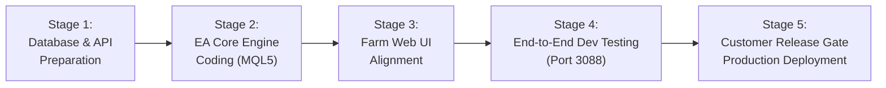

# 🚀 แผนแม่บทการพัฒนา EasyM PRIME (Phase 2): Master Development Plan
## รวบรวมสถาปัตยกรรม EA Core Engine, Web Alignment Matrix, ระบบความปลอดภัย และการแก้ปัญหาข้อมูลปนเปื้อน (OCT26 Edition)

> **ชื่อเอกสาร:** EasyM Prime Phase 2 Master Development Plan (OCT26)  
> **แนวคิดหลัก (Core Philosophy):** **"EA-First Architecture & Clean Data Integrity"** — ยึดถือความถูกต้อง ความเสถียร และความปลอดภัยของตัว EA ในโปรแกรม MT5 เป็นแกนหลัก แล้วพัฒนาส่วนของ Cloud API, Database และ Web Farm Cockpit ให้สอดประสานกัน 100%  
> **รอบการพัฒนา:** ตุลาคม 2026 (OCT26)  
> **เป้าหมายเวอร์ชัน:** EasyM Prime v2.10+ (Build B26102X) & Next.js Farm Cockpit v2.10  
> **สถานะ:** แผนแม่บทฉบับเดียวที่รวมทุกเอกสาร (Master Consolidated Blueprint) พร้อมนำไปปฏิบัติงานทันที  

---

## 📌 สารบัญ (Table of Contents)
1. [ภาพรวมของแผนงาน & ผังสถาปัตยกรรม (Executive Architecture Overview)](#1-ภาพรวมของแผนงาน--ผังสถาปัตยกรรม-executive-architecture-overview)
2. [ส่วนด่วน: การแก้ไขความถูกต้องของข้อมูลใน EA (Data Integrity & Isolation)](#2-ส่วนด่วน-การแก้ไขความถูกต้องของข้อมูลใน-ea-data-integrity--isolation)
3. [6 เสาหลักทางเทคนิคฝั่ง EA MQL5 (Core EA Engine Specification)](#3-6-เสาหลักทางเทคนิคฝั่ง-ea-mql5-core-ea-engine-specification)
4. [ตารางความสอดคล้องฝั่งหน้าเว็บ (Web Alignment Matrix by EA Feature)](#4-ตารางความสอดคล้องฝั่งหน้าเว็บ-web-alignment-matrix-by-ea-feature)
5. [รายละเอียดการพัฒนาหน้าเว็บ Farm UI & Admin Dashboard](#5-รายละเอียดการพัฒนาหน้าเว็บ-farm-ui--admin-dashboard)
6. [ข้อกำหนดสัญญาการสื่อสารข้อมูล & โครงสร้างฐานข้อมูล (Data Contract & API Protocols)](#6-ข้อกำหนดสัญญาการสื่อสารข้อมูล--โครงสร้างฐานข้อมูล-data-contract--api-protocols)
7. [ลำดับขั้นตอนการลงมือพัฒนาและการทดสอบ (Implementation & Verification Stages)](#7-ลำดับขั้นตอนการลงมือพัฒนาและการทดสอบ-implementation--verification-stages)

---

## 1. ภาพรวมของแผนงาน & ผังสถาปัตยกรรม (Executive Architecture Overview)

ใน **Prime Phase 1** เราประสบความสำเร็จในการสร้างระบบแสดงผลฟาร์ม 20 คู่เงินแบบเรียลไทม์ (2.5D Farm HUD, โดมกักกัน, ลูกแก้ว DD Dial, ปรอทวัดความเสี่ยง, และระบบ Realtime Telemetry) ควบคุมผ่าน Release Gate ได้อย่างเสถียร

ใน **Prime Phase 2 (OCT26)** เราจะยกระดับความสามารถของระบบขึ้นอีกขั้น โดยมุ่งเน้นไปที่:
1. **การปกป้องพอร์ตเชิงรุก (Proactive Defense):** ดักจับข่าวกล่องแดงและรับมือสภาวะที่โบรกเกอร์ลด Leverage เหลือ 1:100
2. **การสื่อสารสองทิศทาง (Two-Way Remote Control):** สั่งเปิด-ปิดคู่เงิน (Active vs Close-Only) จากระยะไกล 100% ไม่ต้องล็อกอินเข้า VPS
3. **ความถูกต้องของข้อมูลสถิติ (Data Integrity & Zero Contamination):** แยกแยะออเดอร์ทองคำ (`XAUUSD`), การเทรดมือ, หรือ EA อื่นออกจากสถิติ EasyM อย่างเด็ดขาดตั้งแต่ต้นทาง
4. **การเก็บสถิติการปิดรวบราคาแยกรายคู่เงิน (Granular Harvest Analytics):** ยิง Event ส่งสถิติ Take Profit ตะกร้าสะสมตลอด 90 วัน
5. **การถ่ายทอดสดออเดอร์รายไม้แบบ On-Demand (Live Trade Terminal):** สตรีมตารางออเดอร์เหมือนแท็บ Trade ใน MT5 เฉพาะตอนที่ผู้ใช้เปิดดูหน้าฟาร์มสด

```mermaid
graph TD
    subgraph EA_MT5["🤖 1. EA MQL5 Prime Engine (MT5 Core)"]
        EA_Integrity["0. Data Integrity (Magic Isolation & Prohibited Asset Guard)"]
        EA_Command["1. Two-Way Remote Command Processor"]
        EA_News["2. News & Leverage Shield (1:100 Guard)"]
        EA_HUD["3. On-Chart HUD Polish (Table F Alert Row & Clean Name)"]
        EA_Rescue["4. Tier-3 Triggered Rescue Slicing"]
        EA_Harvest["5. Pair Batch Close Telemetry (TP Event)"]
        EA_LiveTrade["6. On-Demand Live Trade Stream (Presence-Based)"]
    end

    subgraph CLOUD_API["☁️ 2. Cloud Broker & Supabase Database"]
        DB_Queue[("farm_remote_commands<br/>(Command Queue)")]
        DB_Batch[("farm_batch_events<br/>(90-Day Harvest History)")]
        DB_Status[("farm_port_status<br/>(Telemetry, Split PnL & live_orders JSON)")]
        DB_History[("farm_daily_history<br/>(Clean Daily Records)")]
    end

    subgraph WEB_UI["💻 3. Web Farm Cockpit & Admin Dashboard"]
        WEB_Remote["1. Orb 2 Control Matrix & Dispatcher"]
        WEB_News["2. News Badges & Countdown Timer"]
        WEB_Alert["3. Table F Alert Banner Mirroring"]
        WEB_Rescue["4. Dynamic Dome & Rescue Tier State"]
        WEB_Harvest["5. Realtime Harvest Feed & Top 5 Rankings"]
        WEB_LiveTrade["6. Live Terminal Modal (MT5 Trade View)"]
        WEB_Admin["7. Admin Dashboard & External Activity Inspector"]
    end

    EA_Integrity -->|Clean Filtered Data| DB_Status
    EA_Integrity -->|Clean History Deals| DB_History
    EA_Command <-->|Polling / Execution| DB_Queue
    DB_Queue <-->|Command Dispatch| WEB_Remote
    EA_News -->|News Flags & Times| DB_Status
    DB_Status -->|Display Badges| WEB_News
    EA_HUD -->|Table F Messages| DB_Status
    DB_Status -->|Header Banner Alert| WEB_Alert
    EA_Rescue -->|Rescue Tiers & Exposures| DB_Status
    DB_Status -->|Visual Aura & Dome State| WEB_Rescue
    EA_Harvest -->|Instant BATCH_CLOSE Event| DB_Batch
    DB_Batch -->|Realtime Stream| WEB_Harvest
    EA_LiveTrade -->|Snapshot JSON (viewer_active only)| DB_Status
    DB_Status -->|Realtime Table Stream| WEB_LiveTrade
    DB_Status -->|Filtered Stats| WEB_Admin
```

---

## 2. ส่วนด่วน: การแก้ไขความถูกต้องของข้อมูลใน EA (Data Integrity & Isolation)

จากการตรวจสอบพอร์ตจริงในฐานข้อมูล พบว่าพอร์ตลูกค้าบางส่วนมี **การเทรดทองคำ (XAUUSD)**, **การเทรดมือ (Manual Trades)** หรือ **รัน EA อื่นควบคู่ในพอร์ตเดียว** (เช่น `#97130324` ติดลบออเดอร์นอกระบบ -12,430 USC, `#97115162` แปะกราฟทองคำ) ส่งผลให้ตัวเลขในหน้าแดชบอร์ดเพี้ยน ดังนั้นใน Phase 2 จึงต้องใส่ตัวบล็อก 3 ด่านนี้ในตัว EA ทันที:

### 2.1 กรอง Magic Number ในประวัติปิดออเดอร์ (History Deal Filtering)
* **ปัญหาเดิม:** ในฟังก์ชัน `EAE_ScanHistoryDailySummary` (`EAE_WebSync.mqh`) และ `EAE_ScanHistoryToday` (`EAE_Licensing.mqh`) ในบล็อก Portfolio (`magicB == magicS`) ไม่ได้ตรวจ Magic Number ของ Deal ปิด ส่งผลให้เมื่อลูกค้าปิดทองคำหรือเทรดมือ ยอดกำไรและล็อตทั้งหมดถูกเหมาเป็นของ EasyM
* **การแก้ไข (ดำเนินการแล้วในโค้ด และต้องรวมในบิลด์ใหม่):**
  ```mql5
  // ใน EAE_ScanHistoryDailySummary และ EAE_WebSyncPushHistoryBatch
  if(entry == DEAL_ENTRY_OUT || entry == DEAL_ENTRY_INOUT)
  {
     long magic = HistoryDealGetInteger(ticket, DEAL_MAGIC);
     if(magicB == magicS && magicB > 0) {
        if(!EAE_IsPortfolioMagic(magic, magicB)) continue; // กรองเด็ดขาดเฉพาะ Magic ของ EasyM!
     }
     ...
  }
  ```
  - ช่วง Magic ที่ EasyM ครอบคลุม:
    - Base 20-Pair Grids: `2000 .. 2099`
    - Sniper Rescue Orders: `3000 .. 3099`
    - Auto-Hedge Delta=0 Orders: `4000 .. 4099`

### 2.2 ป้องกันการลาก EA ไปแปะชาร์ตทองคำ (Prohibited Chart Asset Guard)
* **ปัญหาเดิม:** ลูกค้าเผลอลาก EasyM ไปแปะบนชาร์ต `XAUUSD` หรือ `GOLD` ทำให้ EA รายงาน `asset_type = 'GOLD'`
* **ข้อกำหนดใน `OnInit()`:**
  ```mql5
  string current_sym = _Symbol;
  StringToUpper(current_sym);
  if(StringFind(current_sym, "XAU") >= 0 || StringFind(current_sym, "GOLD") >= 0)
  {
     Alert("❌ [EasyM Safety Error] ไม่อนุญาตให้ติดตั้ง EasyM บนชาร์ตทองคำ (XAUUSD)! กรุณาติดตั้งบนชาร์ตคู่เงิน Forex ที่กำหนด (เช่น EURUSD)");
     Print("CRITICAL: EasyM attached to prohibited asset: ", _Symbol);
     return INIT_FAILED; // สั่งหยุดทำงานทันที ป้องกันความเสียหายต่อพอร์ต
  }
  ```

### 2.3 ส่งค่าแยกเฉพาะ EasyM ชัดเจนใน Heartbeat Payload (Split Authoritative Metrics)
* ให้ EA ส่งตัวเลขเฉพาะส่วนของ EasyM แยกจากค่ารวมของพอร์ต MT5:
  - `easym_floating_pnl`: `buy_pnl + sell_pnl` ของออเดอร์ EasyM
  - `easym_equity`: `balance + easym_floating_pnl`
  - `external_floating_pnl`: `account_equity - easym_equity` (ส่วนต่างติดลบ/กำไรของออเดอร์นอกระบบ)
  - `has_external_orders`: ตรวจจับว่าใน `PositionsTotal()` มีออเดอร์ที่ไม่ใช่ Magic ของ EasyM หรือไม่

---

## 3. 6 เสาหลักทางเทคนิคฝั่ง EA MQL5 (Core EA Engine Specification)

### 🛰️ เสาหลักที่ 1: ระบบการสื่อสารสองทาง (Two-Way Remote Command Execution)
* **วัตถุประสงค์:** สั่งเปิด-ปิดคู่เงิน (Active vs Close-Only) หรือหยุดฉุกเฉินจากหน้าเว็บได้ 100% ไม่ต้องเข้า VPS
* **กลไกการทำงาน:**
  1. EA ทำการ Poll คำสั่งจาก API `/api/farm/command/poll` ผ่าน Heartbeat ทุกๆ 2–5 วินาที
  2. เมื่อพบคำสั่ง `SET_PAIR_MODE`:
     - หากเป็น `CLOSE-ONLY`: EA จะระงับการเปิดไม้แรก (First Entry) ของคู่เงินนั้น แต่ตรรกะการคุมตะกร้าเดิมและการปิดรวบทำกำไร (Basket TP) ยังทำงานต่อเนื่องจนออเดอร์หมด
     - หากเป็น `ACTIVE`: EA จะปลดบล็อกให้คู่เงินนั้นสามารถรับสัญญาณเทรดและเข้าออเดอร์ตามปกติ
  3. คำสั่งอื่นๆ ที่รองรับ:
     - `PAUSE_ALL_NEW`: สลับทุกคู่เป็น Close-Only ทันทีเมื่อตลาดผันผวนรุนแรง
     - `RESUME_ALL`: คืนค่าการทำงานของทุกคู่
     - `EMERGENCY_LOCK_PAIR`: สั่งย้ายคู่เงินเข้าห้องขัง Quarantine ด้วยตนเองทันที
  4. **Watchdog Fallback:** หากเน็ตหลุดเกิน 60 วินาที EA จะรักษาโหมดความปลอดภัยล่าสุดไว้ และจะปฏิเสธคำสั่งที่ค้างส่งเกิน 3 นาที เพื่อความปลอดภัยสูงสุด

---

### 🛡️ เสาหลักที่ 2: ระบบเกราะป้องกันข่าวและ Leverage ตก 1:100 (News Filter & Leverage Drop Shield)
* **ปัญหาและที่มา:** โบรกเกอร์ (เช่น FISG) ปรับลด Leverage สำหรับ Forex/ทองคำ เหลือ **1:100** ในช่วงข่าวกล่องแดง (Red Folder) ตั้งแต่ **4 นาทีก่อนข่าว จนถึง 1 นาทีหลังข่าว** ส่งผลให้เงินมาร์จิ้นที่ต้องใช้ออกไม้พุ่งสูงขึ้น 5–10 เท่า หาก EA ต้องเปิดไม้แก้ช่วงนี้ คำสั่งจะโดนปฏิเสธทันที (`TRADE_RETCODE_NO_MONEY`) และสเปรดที่ถ่างกว้างอาจบีบให้พอร์ตติด Stop Out
* **กลไกการทำงานของ EA:**
  1. ระบบอ่านปฏิทินข่าว High Impact (ความสำคัญระดับ 3) ผ่าน `CalendarValueHistory()` ของ MT5 หรือ Cloud Sync API
  2. การตั้งค่าพารามิเตอร์:
     - `InpNewsFilterEnabled` = `true`
     - `InpMinsBeforeNews` = `10` นาที (ครอบคลุมเกณฑ์ 4 นาทีของโบรกเกอร์)
     - `InpMinsAfterNews` = `10` นาที (ครอบคลุมเกณฑ์ 1 นาทีของโบรกเกอร์ และรอสเปรดหด)
     - `InpMaxAllowedSpread` = `35` (หากสเปรดยังถ่างเกินกำหนดจะไม่เปิดไม้เด็ดขาด)
  3. **Currency Matching Engine:** ข่าวของสกุลเงินใด จะหยุดการออกไม้เฉพาะคู่เงินที่มีสกุลนั้นประกอบอยู่เท่านั้น (เช่น ข่าว USD จะหยุดเฉพาะ EURUSD, GBPUSD แต่คู่ EURJPY ทำงานต่อได้ตามปกติ)

---

### 📊 เสาหลักที่ 3: การปรับแต่งแดชบอร์ดบนกราฟ MT5 ให้เป็นมืออาชีพ (MT5 On-Chart HUD Polish)
1. **ปรับชื่อแบรนด์ให้ตรงกัน (Unified Branding):**
   - ตัดคำว่า `Universal` ออกจาก Table C บนกราฟ
   - ปรับเป็นมาตรฐานเดียวกับเว็บ: `EasyM Prime v2.00 [BuildID]` (เช่น `EasyM Prime v2.00 1014 [B261014.1]`)
2. **เพิ่ม Table F เต็มแถวเดี่ยว (Dedicated Full-Width Alert Row):**
   - ย้ายข้อความแจ้งเตือนทั้งหมดออกจาก Table E ช่องขวา มาแสดงผลใน **Table F** ความกว้างเต็มแถว 100% (`dW`)
   - ทำให้ Table E มีพื้นที่แสดงเฉพาะตัวเลขการเงิน (Buffer % และ Relief Fund) ได้ชัดเจน ไม่เบียดเสียด
   - Table F มีระบบ Priority Message Queue สลับสีตามความสำคัญ (วิกฤต = แดง, ข่าว = ทอง, ออเดอร์นอกระบบ = ส้ม, ปกติ = เขียว)
3. **สแกนตรวจจับออเดอร์ผิดปกติ (Anomaly & Legacy Basket Detection):**
   - ฟังก์ชัน `ScanLegacyBaskets()`: ตรวจหาคู่เงินเก่าของ EasyM ที่อยู่นอก 20 คู่ปัจจุบัน (เช่น GBPCHF) และรายงานสถานะรอปิดรวบ
   - ฟังก์ชัน `ScanExternalTrades()`: ตรวจจับออเดอร์เทรดมือ (`Magic == 0`), EA อื่น หรือคู่เงินแปลกปลอม (เช่น XAUUSD, BTCUSD) ที่เข้ามากิน Margin ของพอร์ต

---

### 🎯 เสาหลักที่ 4: สถาปัตยกรรมกู้ภัยระดับสูง (Tier-3 State-Driven Rescue Slicing)
* **ปัญหาและที่มา:** เดิมเมื่อสไนเปอร์กู้ชีพสะสมกำไรครบ 3 รอบ จะตัดเฉพาะไม้ Regular Grid ปกติเสมอ แต่หากตลาดเกิด Super-Trend จนระบบต้องงัดไม้กู้ภัยชุดสุดท้าย (**Tier 3**) ออกมาใช้ ไม้กู้ภัยชุดที่ 1 ที่เปิดไว้ด้านบนจะกลายเป็น **"ไม้กู้ภัยติดดอย"** ทำให้พอร์ตแบกรับ Lot ส่วนเกิน เสี่ยงต่อการถูกลากไปชน 40% Auto-Hedge
* **กลไกการทำงานของ EA:**
  1. ตรวจสอบระดับสถานะกู้ภัย (`st.rescueTier`):
     - **ช่วง Tier 1 & Tier 2:** กำไร 3 รอบ มุ่งเป้าตัดไม้ Regular Grid ดอยแรกสุด เพื่อดึง TP เฉลี่ยของกริดหลักลงมาหาตลาด
     - **ช่วง Tier 3 ถูกงัดมาใช้งาน:** สลับเป้าหมายทันที! กำไร 3 รอบจะนำไป **ตัดไม้กู้ภัยชุดที่ 1 ที่ติดดอยทิ้งเป็นอันดับแรก**
  2. การสลัดล็อตไม้กู้ภัยด้านบนออก จะช่วยกางร่มชูชีพเบรกล็อตสะสมทันที ป้องกันไม่ให้พอร์ตหลุดไปชน 40% Auto-Hedge

---

### 🌾 เสาหลักที่ 5: ระบบส่งสถิติจังหวะปิดรวบราคาแยกรายคู่เงิน (Pair Basket Closure Telemetry)
* **ปัญหาและที่มา:** เดิม EA ส่งเฉพาะยอดรวมรายวัน ทำให้ไม่ทราบว่าคู่เงินไหนปิดรวบราคาไปกี่รอบ เวลาไหน และคู่ใดทำกำไรได้มากที่สุด
* **กลไกการทำงานของ EA:**
  1. ในฟังก์ชันจังหวะที่แต่ละคู่เงินปิดรวบตะกร้ากำไรสำเร็จ (Cycle TP / Basket Close):
     ```cpp
     EAE_WebSyncTriggerEvent("BATCH_CLOSE", sym, orders_count, total_lots, realized_pnl);
     ```
  2. ยิง Event ขึ้น API ทันทีเฉพาะตอนปิดรอบ (Event-driven) ไม่หน่วงเครื่อง ไม่เปลือง Bandwidth
  3. ส่งข้อมูลระบุชื่อคู่เงิน, จำนวนไม้ที่ปิด, Lot รวม, และกำไรเป็นราย Event บันทึกลงตาราง `farm_batch_events`

---

### ⚡ เสาหลักที่ 6: ระบบถ่ายทอดสดออเดอร์รายไม้แบบ On-Demand (On-Demand Live Trade Streaming Engine)
* **ปัญหาและที่มา:** ลูกค้าต้องการตรวจสอบสถานะออเดอร์ที่เปิดอยู่จริงแบบรายตั๋ว (Ticket) เหมือนหน้าต่าง Trade ของ MT5 บนมือถือหรือหน้าเว็บ แต่หากให้ EA ส่งข้อมูลไม้ย่อยตลอดเวลาจะเปลือง CPU, Bandwidth และ Database Write IOPS
* **กลไกการทำงานของ EA:**
  1. **สภาวะ On-Demand (Presence-Based Trigger):** EA จะตรวจสอบค่า `viewer_active` จากผลตอบกลับของ Heartbeat
     - หาก `viewer_active == true` (มีลูกค้าเปิดหน้าฟาร์มดูสดอยู่):
       - EA จะวนลูปอ่าน `PositionsTotal()` และ `PositionGetTicket()`
       - ดึงข้อมูล: Ticket, Open Time, Symbol, Type (Buy/Sell), Lots, Open Price, Current Price, S/L, T/P, Swap, P/L
       - แพ็กรวมเป็น JSON Snapshot ก้อนเดียว `live_orders: [...]` (ขนาดเพียง ~4-6 KB)
       - แนบส่งไปกับ Payload ทุกๆ 10-15 วินาที
     - หาก `viewer_active == false` (ลูกค้าปิดหน้าเว็บหรือสลับแท็บเกิน 2 นาที):
       - EA จะตัดการอ่านและหยุดส่งข้อมูลไม้ย่อยสดทันที สลับกลับสู่โหมดจำศีล (Sleep Standby 180s) ประหยัดทรัพยากรเครื่อง VPS 100%

---

## 4. ตารางความสอดคล้องฝั่งหน้าเว็บ (Web Alignment Matrix by EA Feature)

| ลำดับ | เสาหลักฝั่ง EA (Core Engine) | ข้อมูลที่ EA ส่งขึ้น Cloud | สิ่งที่หน้าเว็บ / Farm UI ต้องทำเพื่อสอดคล้อง | ผลลัพธ์บนหน้าจอผู้ใช้ |
| :---: | :--- | :--- | :--- | :--- |
| **0** | **Data Integrity & Isolation** | ส่ง `easym_floating_pnl`, `external_floating_pnl`, `has_external_orders` | คำนวณ EasyM Equity แยกจากยอด MT5 รวม และมีปุ่ม Inspector Modal | สถิติกำไรและ Drawdown สะท้อนผลงานจริงของบอท 100% ไม่ปนยอดเทรดมือ |
| **1** | **Two-Way Remote Command** | อ่านสถานะ `enabled` และ `close_only` จาก Database | พัฒนา Command Dispatcher ใน Orb 2 พร้อม Modal ยืนยันความปลอดภัย | ผู้ใช้สามารถคลิกเปิด-ปิดคู่เงิน หรือชะลอการออกไม้จากหน้าเว็บได้จริง |
| **2** | **News & Leverage Shield** | ส่ง Flag `is_news_blocked`, สกุลเงินข่าว, และเวลานับถอยหลัง | แสดงป้ายเตือนกะพริบ `📰 NEWS (1:100)` บนการ์ดคู่เงินที่ได้รับผลกระทบ | ผู้ใช้ทราบทันทีว่าทำไมคู่นั้นถึงไม่เปิดไม้ และมีเวลานับถอยหลังบอกชัดเจน |
| **3** | **On-Chart Table F Alert** | ส่งสตริงข้อความแจ้งเตือน Table F และระดับความรุนแรง (Severity) | นำข้อความแจ้งเตือนมาแสดงเป็น Top Farm Banner สไตล์ Sci-Fi HUD | แจ้งเตือนทันทีหากมีคนเทรดมือ หรือมีคู่เงินเก่าค้างพอร์ต |
| **4** | **Tier-3 Rescue Slicing** | ส่งสถานะ `rescue_tier` (1, 2, 3) และจำนวนไม้กู้ภัยที่ถูกตัดทอน | ปรับกราฟิกรัศมีของโดมกักกัน (Energy Dome) และไอคอนไม้สไนเปอร์ตาม Tier | เห็นชัดเจนว่าระบบกำลังกู้ภัยระดับไหน และกำลังตัดไม้ดอยตัวใด |
| **5** | **Pair Basket Telemetry** | ยิง Event `BATCH_CLOSE` ระบุ `sym`, `orders`, `lots`, `profit` | ดึงข้อมูลจาก `farm_batch_events` มาแสดง **Realtime Harvest Feed** และ **Top 5 Pairs Ranking** | ผู้ใช้เห็นฟีดการเก็บเกี่ยวสดตลอดวัน และรู้ว่าคู่ไหนทำเงินสูงสุด |
| **6** | **On-Demand Live Trades** | ส่ง Snapshot JSON `live_orders: [...]` ทุก 10-15s (เฉพาะตอนมีคนดู) | พัฒนาหน้าต่าง **Live Terminal Modal (MT5 Trade Tab Emulator)** และคลี่ดูรายคู่ | ผู้ใช้เห็นราคาเปิด กำไร และทุกล็อตสดๆ แบบเดียวกับหน้าจอ MT5 |

---

## 5. รายละเอียดการพัฒนาหน้าเว็บ Farm UI & Admin Dashboard

### 5.1 ระบบคัดกรองพอร์ตและ External Activity Inspector บน Admin Dashboard
* **ทำเสร็จแล้วในระบบ:**
  - บนหน้า [easym-dashboard/page.tsx](file:///Users/suphakorn/EA%20Market%20Place/ea-market-place/src/app/admin/easym-dashboard/page.tsx) มีระบบตรวจจับ `ExternalActivityInfo` พร้อมตัวกรอง Quick Filter `⚠️ ปนเทรดนอกระบบ/ทองคำ`
  - กล่องพอร์ตใน 100-Port Matrix, Customer View, และ Flat Table แสดงป้ายเตือนสีส้มที่คลิกได้
  - เมื่อคลิกจะเปิด **External Activity Inspector Modal** เปรียบเทียบ 3 คอลัมน์:
    1. *ค่าดิบทั้งพอร์ตจาก MT5* (Equity, Floating, Today PnL ดิบ)
    2. *เฉพาะออเดอร์ EasyM* (EasyM Equity, EasyM Floating, ไม้ Buy/Sell ที่ถือครองจริง)
    3. *ส่วนต่างที่ไม่ได้มาจาก EasyM* (ยอดติดลบนอกระบบ, Today PnL ที่ตัดออก, ล็อตปิดรวม)

### 5.2 การเชื่อมต่อคำสั่งระยะไกล (Orb 2 Matrix & Command Dispatcher)
* **หน้าต่างยืนยันความปลอดภัย (Confirmation Modal):**
  - แสดงชื่อคู่เงิน, โหมดเป้าหมาย (`ACTIVE` หรือ `CLOSE-ONLY`), และผลกระทบต่อพอร์ต ป้องกันการกดพลาดโดยไม่ตั้งใจ
* **การส่งคำสั่งเข้าคิว (Database Queue):**
  - บันทึกลงตาราง `farm_remote_commands` สถานะ `PENDING` เมื่อ EA รันแล้วจะสะท้อนกลับเป็น `EXECUTED`

### 5.3 คอมโพเนนต์ Live Terminal (MT5 Trade Tab Emulator)
* **หน้าต่าง Live Terminal:**
  - เมื่อคลิกดู *"ไม้สด (Live Trades)"* บนการ์ดคู่เงินหรือแถบเครื่องมือ จะเปิด Modal แสดงตารางเหมือนหน้าต่าง Trade ของ MT5:
    `Ticket #` | `Time` | `Pair` | `Type (Buy/Sell)` | `Lots` | `Open Price` | `Current Price` | `S/L` | `T/P` | `Swap` | `Profit (USD/USC)`

---

## 6. ข้อกำหนดสัญญาการสื่อสารข้อมูล & โครงสร้างฐานข้อมูล (Data Contract & API Protocols)

### 6.1 โครงสร้างตารางฐานข้อมูล Supabase

```sql
-- 1. ตารางคิวคำสั่งสองทิศทาง (farm_remote_commands)
CREATE TABLE IF NOT EXISTS public.farm_remote_commands (
    id UUID PRIMARY KEY DEFAULT uuid_generate_v4(),
    port_number TEXT NOT NULL,
    action TEXT NOT NULL, -- 'SET_PAIR_MODE', 'PAUSE_ALL', 'RESUME_ALL', 'EMERGENCY_QUARANTINE'
    symbol TEXT,          -- เช่น 'EURUSD' หรือ NULL หากเป็นคำสั่งรวมทั้งพอร์ต
    payload JSONB DEFAULT '{}'::jsonb,
    status TEXT NOT NULL DEFAULT 'PENDING', -- 'PENDING', 'EXECUTED', 'EXPIRED', 'FAILED'
    created_at TIMESTAMPTZ DEFAULT NOW(),
    executed_at TIMESTAMPTZ
);

CREATE INDEX IF NOT EXISTS idx_remote_commands_port_status ON public.farm_remote_commands(port_number, status);

-- 2. ตารางประวัติการปิดรวบตะกร้ารายคู่เงิน (farm_batch_events)
CREATE TABLE IF NOT EXISTS public.farm_batch_events (
    id UUID PRIMARY KEY DEFAULT uuid_generate_v4(),
    port_number TEXT NOT NULL,
    symbol TEXT NOT NULL,
    total_orders INTEGER NOT NULL,
    total_lots DOUBLE PRECISION NOT NULL,
    total_profit DOUBLE PRECISION NOT NULL,
    event_timestamp TIMESTAMPTZ DEFAULT NOW()
);

CREATE INDEX IF NOT EXISTS idx_batch_events_port_sym ON public.farm_batch_events(port_number, symbol);
CREATE INDEX IF NOT EXISTS idx_batch_events_time ON public.farm_batch_events(event_timestamp DESC);

-- Enable Realtime for Harvest Feed
ALTER PUBLICATION supabase_realtime ADD TABLE public.farm_batch_events;

-- Auto-cleanup 90 วัน
CREATE OR REPLACE FUNCTION public.cleanup_old_farm_data()
RETURNS void AS $$
BEGIN
    DELETE FROM public.farm_batch_events
    WHERE event_timestamp < NOW() - INTERVAL '90 days';
END;
$$ LANGUAGE plpgsql SECURITY DEFINER;

-- 3. เพิ่มคอลัมน์ live_orders แบบ JSONB ใน farm_port_status (เก็บออเดอร์สดก้อนเดียว ไม่เปลือง Table)
ALTER TABLE public.farm_port_status ADD COLUMN IF NOT EXISTS live_orders JSONB DEFAULT '[]'::jsonb;
ALTER TABLE public.farm_port_status ADD COLUMN IF NOT EXISTS easym_floating_pnl NUMERIC(12,2);
ALTER TABLE public.farm_port_status ADD COLUMN IF NOT EXISTS easym_equity NUMERIC(14,2);
ALTER TABLE public.farm_port_status ADD COLUMN IF NOT EXISTS has_external_orders BOOLEAN DEFAULT FALSE;
```

---

## 7. ลำดับขั้นตอนการลงมือพัฒนาและการทดสอบ (Implementation & Verification Stages)



### 🔹 Stage 1: เตรียมฐานข้อมูลและ API (Database & API Preparation)
- [x] ตรวจสอบ API [`verify-license/route.ts`](file:///Users/suphakorn/EA%20Market%20Place/ea-market-place/src/app/api/verify-license/route.ts) ไม่ให้เขียนทับค่า EasyM Floating PnL ด้วยยอดติดลบรวมของพอร์ต MT5
- [ ] รันคำสั่ง SQL สร้างตาราง `farm_remote_commands`
- [ ] รันคำสั่ง SQL เพิ่มคอลัมน์ `symbol` ใน `farm_batch_events`
- [ ] รันคำสั่ง SQL เพิ่มคอลัมน์ `live_orders JSONB` ใน `farm_port_status`
- [ ] สร้าง Endpoint `/api/farm/command/send` และ `/api/farm/command/poll`

### 🔹 Stage 2: พัฒนาโค้ดฝั่งตัว EA (EA Core Engine Coding - MQL5)
- [x] กรอง Magic Number ในประวัติปิดออเดอร์ใน [EAE_WebSync.mqh](file:///Users/suphakorn/EA%20Market%20Place/Finishing%20EAeze%20Products/EAE_WebSync.mqh) และ [EAE_Licensing.mqh](file:///Users/suphakorn/EA%20Market%20Place/Finishing%20EAeze%20Products/EAE_Licensing.mqh)
- [ ] ใส่ระบบตรวจสอบ `Chart Asset Guard` ใน `OnInit()` ยับยั้งการติดตั้งบนชาร์ตทองคำ (`XAUUSD`/`GOLD`)
- [ ] ปรับชื่อใน `#define EA_DASH_TITLE` ตัดคำว่า `Universal` ออกเป็น `EasyM Prime v2.00 [BuildID]`
- [ ] ปรับ Table E ให้แสดงเฉพาะ Buffer % และ Relief Fund
- [ ] สร้าง Table F เต็มแถว พร้อมระบบจัดลำดับความสำคัญของข้อความแจ้งเตือน (Priority Queue)
- [ ] พัฒนาฟังก์ชัน `ScanLegacyBaskets()` และ `ScanExternalTrades()` ส่งขึ้น Table F
- [ ] พัฒนาโมดูล `NewsFilterModule.mqh` ตรวจจับข่าวกล่องแดงและหยุดเปิดไม้ช่วงลด Leverage 1:100
- [ ] ปรับปรุงฟังก์ชัน `TrimOneToxicTicket()` เพิ่มตรรกะสลับตัดไม้กู้ภัยชุดที่ 1 เมื่อเข้าสู่ Tier 3
- [ ] เพิ่มคำสั่ง `EAE_WebSyncTriggerEvent("BATCH_CLOSE", sym, ...)` ในจังหวะ Take Profit แต่ละคู่เงิน
- [ ] เพิ่มฟังก์ชัน `ProcessRemoteWebCommands()` ดึงคำสั่งจาก Cloud ไปปฏิบัติการ
- [ ] เพิ่มฟังก์ชัน `BuildLiveOrdersJsonSnapshot()` รวบรวมไม้ย่อยสดส่งขึ้น Cloud (ทำงานเฉพาะเมื่อ `viewer_active == true`)

### 🔹 Stage 3: พัฒนาหน้าเว็บฟาร์มให้สอดรับ (Farm Web UI Alignment)
- [x] พัฒนาระบบตรวจจับ External Activity และ Inspector Modal บน [easym-dashboard/page.tsx](file:///Users/suphakorn/EA%20Market%20Place/ea-market-place/src/app/admin/easym-dashboard/page.tsx)
- [ ] เชื่อมต่อปุ่มใน Orb 2 ส่งคำสั่งเข้า Database พร้อม Modal กดยืนยัน
- [ ] เพิ่ม News Badges และ Countdown Timer บนการ์ดคู่เงินที่ติดข่าว
- [ ] ดึงข้อความจาก Table F มาแสดงเป็น Banner แจ้งเตือนที่หัวฟาร์ม
- [ ] พัฒนาคอมโพเนนต์ **Realtime Harvest Feed** และ **Top 5 Pairs Ranking**
- [ ] ผูกข้อมูล Telemetry เข้ากับไซโลเสบียง (Golden Silo) และเกราะพลังงาน (Bio-Shield)
- [ ] พัฒนาหน้าต่าง **Live Terminal Modal (MT5 Trade Tab Emulator)** แสดงออเดอร์สดจากฟิลด์ `live_orders`

### 🔹 Stage 4: การทดสอบบนพอร์ตพัฒนา (Verification on Port 3088)
- [ ] รัน EA ตัวทดสอบบนพอร์ตพัฒนา **97053088**
- [ ] ทดสอบคลิกเปลี่ยนโหมดคู่เงินจากหน้าเว็บ แล้วดูผลตอบรับบน MT5
- [ ] ทดสอบจำลองสถานะข่าวกล่องแดงและการหยุดออกไม้
- [ ] ทดสอบปิดรวบราคา แล้วตรวจดูการเด้งขึ้นของ Harvest Feed บนหน้าเว็บ
- [ ] ทดสอบเปิดหน้าเว็บฟาร์ม แล้วตรวจดูว่าตาราง Live Terminal สตรีมไม้ย่อยสดจาก MT5 ตรงกันแบบ Real-time
- [ ] ทดสอบปิดแท็บหน้าเว็บ แล้วตรวจดูว่า EA สลับตัดการส่งไม้ย่อยสดกลับสู่ Sleep Standby ภายใน 2 นาทีจริง
- [ ] ตรวจเช็กการแสดงผล Table F บนหน้าจอ MT5

### 🔹 Stage 5: ปล่อยใช้งานจริงผ่าน Release Gate (Production Deployment)
- [ ] ตรวจสอบความถูกต้องของแดชบอร์ดบนกราฟ MT5
- [ ] รวบรวมคอมไพล์ไฟล์ `.ex5` เวอร์ชั่นใหม่
- [ ] ปลดล็อกสิทธิ์ผ่าน Dev Controller ปล่อยหน้าฟาร์ม Phase 2 ให้ลูกค้าทุกคนใช้งาน

---
*เอกสารแผนแม่บท Prime Phase 2 Master Development Plan (OCT26)*  
*รวบรวมและจัดทำเป็นเอกสารเดี่ยวสมบูรณ์โดย: Antigravity AI Pair Programmer & System Architect*  
*ไฟล์อ้างอิงหลัก:* [`docs/PRIME_PHASE2_MASTER_DEVELOPMENT_PLAN.md`](file:///Users/suphakorn/EA%20Market%20Place/ea-market-place/docs/PRIME_PHASE2_MASTER_DEVELOPMENT_PLAN.md)
