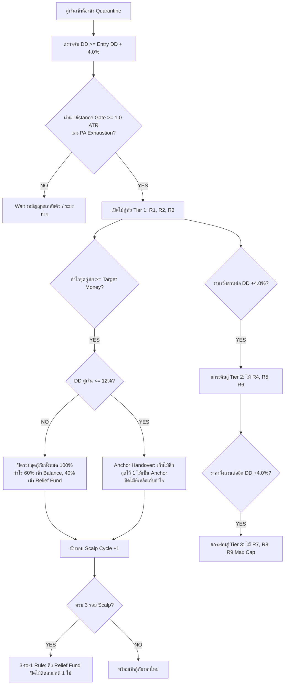

# 🛡️ EasyM Prime Architecture Specification: v2.00-1014 [Build B261014.1]
> **Multi-Tier Cascading Rescue & Anchor Handover Architecture**  
> **Release Date:** 2026-10-14  
> **Target Products:** `EasyM_Prime_v200_B261014_1.mq5 / .ex5`  
> **Reference System:** Universal Multi-Pair Portfolio Engine (20 Active Pairs + 3 Legacy Close-Only)

---

## 1. Executive Summary & Problem Diagnosis

### ปัญหาที่พบในเวอร์ชันเดิม (`v2.00-1013 [B261013.2]`):
1. **Rescue Lockout Bug (`count < 3`):**  
   ใน `v2.00-1013` มีเงื่อนไขในฟังก์ชัน `TryCloseTopTwoRescueOrders()` บังคับว่า `if (count < 3) return false;` ส่งผลให้พอร์ตจริง (เช่น พอร์ต Admin `21692434` และ `97053088`) ที่มีไม้กู้ภัยเปิดอยู่ 1 หรือ 2 ไม้ และมีกำไรสะสมสูงถึง `+467` ถึง `+704 Cent` **ไม่สามารถปิดทำกำไรได้เลย** เพราะไม้กู้ภัยยังออกไม่ครบ 3 ไม้
2. **จุดเข้าไม้แรกแข็งตัวเกินไป:**  
   เดิมใช้ `InpRescueTriggerPct = 25.0%` หรือ `Entry DD + 8.0%` ซึ่งในบางสภาวะตลาดทำให้จุดเข้ากู้ภัยลึกเกินไป ไม่สามารถดักเก็บกำไรจากรอบการแกว่งตัวต้นทางได้
3. **ปัญหาการดีดกลับเข้าห้องขัง (Quarantine Oscillation Trap):**  
   เกณฑ์ปล่อยตัวเดิมอยู่ที่ 8.0% หรือ 12.0% คงที่ หากพอร์ตติดสถานะ SLOW/FREEZE แล้วคู่เงินฟื้นตัวมาที่ 10-12% อาจเกิดอาการหลุดขังแล้วเด้งกลับเข้าไปขังใหม่ซ้ำซ้อน
4. **ความเสี่ยงในการสูญหายของสถานะเมื่อ Restart:**  
   เมื่อ VPS รีสตาร์ตหรือมีการ Compile ลง EA ใหม่ ค่า `g_quarantineEntryDD` ในหน่วยความจำอาจถูกรีเซ็ต ทำให้ไม่รู้ว่าคู่เงินเดิมโดนขังที่จุดใด

---

## 2. เสาหลักสถาปัตยกรรมใหม่ 8 ประการ (8 Core Pillars of B261014.1)



---

### เสาหลักที่ 1: Dynamic Rescue Trigger & Distance Gate
* **จุดเริ่มต้นกู้ภัยแบบยืดหยุ่น:**  
  คำนวณจาก `Quarantine Entry DD + InpRescueTriggerDeltaPct` (ค่าเริ่มต้น +4.0%)  
  * หากเข้าขังแบบ Standalone Runaway ที่ 14.0% $\rightarrow$ จุดเริ่มกู้ภัยคือ $14.0\% + 4.0\% = \mathbf{18.0\%}$
  * หากเข้าขังแบบ Portfolio Adaptive Freeze ที่ 10.0% $\rightarrow$ จุดเริ่มกู้ภัยคือ $10.0\% + 4.0\% = \mathbf{14.0\%}$
* **Distance Gate ร่วมกับ ATR (Daily D1):**  
  ไม้กู้ภัยไม้แรกต้องห่างจากไม้สุดท้ายของตระกร้าปกติอย่างน้อย `MathMax(InpRescueFirstGapPips, ATR_D1 * 1.0)` ป้องกันการเปิดไม้ถี่เกินไปในสภาวะตลาดผันผวนสูง

### เสาหลักที่ 2: 100% Price Action Exhaustion Confirmation บนทุกไม้
* ตรวจสอบพฤติกรรมแท่งเทียนก่อนยิงไม้กู้ภัย**ทุกไม้ (R1 ถึง R9)** ผ่าน `IsRescueExhaustionConfirmed()`:
  1. **Rejection Wick:** ไส้เทียนปฏิเสธราคา $\ge 35\%$ ของความยาวแท่งเทียน
  2. **Reversal Bar:** แท่งเทียนกลับตัวแท่งแรก (แท่งเขียวสำหรับ Buy, แท่งแดงสำหรับ Sell)
  3. **Consolidation Box:** การชะลอตัวและบีบแคบของกรอบราคา ($\le 50\%$ ของค่าเฉลี่ย 3 แท่งก่อนหน้า)
  4. **Strict Anti-Runaway Failsafe:** บล็อกการเข้าไม้เด็ดขาดหากพบแท่งเทียน Waterfall หรือ Rocket Spike ที่เนื้อเทียนหนาเกิน 75% และแทบไม่มีไส้เทียน

### เสาหลักที่ 3: สถาปัตยกรรมกู้ภัย 3 ระดับขั้นบันได (Multi-Tier 3-Stage Cascading Escalation)
* **Tier 1 (ไม้ 1–3):** ยิงเมื่อแตะเกณฑ์ Entry DD + 4.0% พร้อม Distance Gate และ PA Exhaustion
* **Tier 2 (ไม้ 4–6):** หากเปิดครบ 3 ไม้แล้วราคายังไม่ดีดตัวกลับ และ DD ลากลึกเพิ่มอีก $\mathbf{+4.0\%}$ จากจุดเปิดไม้สุดท้ายของ Tier 1 ระบบจะยกระดับเข้าสู่ Tier 2
* **Tier 3 (ไม้ 7–9):** หาก Tier 2 ยังไม่ฟื้นและ DD ลากเพิ่มอีก $\mathbf{+4.0\%}$ จะเข้าสู่ Tier 3 สูงสุดไม่เกิน 9 ไม้ (Hard Cap)
* **ขนาดล็อตขั้นบันไดต่อเนื่อง (Continuous Ladder Lot):**  
  ล็อตไม้กู้ภัยวิ่งตามสูตร `LadderLot(regularCount + rescueCount + 1)` โดยมีเพดาน `InpHardMaxLotPerPos` (1.10 lot) ควบคุมทุกไม้ไม่ให้เปิดโอเวอร์เทรด

### เสาหลักที่ 4: ปิดรวบกำไรชุดกู้ภัยอย่างอิสระ (Independent Rescue Basket Profit Taking)
* ตัดเงื่อนไข `count < 3` ทิ้งทั้งหมด!
* ชุดกู้ภัยสามารถปิดทำกำไรได้ทันทีที่ผลรวม PnL ของไม้กู้ภัยที่เปิดอยู่ $\ge \mathbf{InpRescueTargetMoney}$ (ค่าเริ่มต้น 20.0 Cent) ไม่ว่าจะมี 1, 2 หรือ 3 ไม้ก็ตาม
* สัดส่วนกำไร:
  * **60% เข้า Balance พอร์ต** เพิ่มสภาพคล่องและกำไรรายวันทันที
  * **40% เข้า Relief Fund** (`g_accumulatedReliefBudget`) สะสมไว้ใช้ตัดไม้ติดลบ

### เสาหลักที่ 5: Anchor Handover ที่ DD 12%
* เมื่อชุดกู้ภัยทำกำไรถึงเป้า และ DD ของคู่เงินลดลงมาแตะ $\mathbf{\le 12.0\%}$:
  * ระบบจะไม่ปิดไม้กู้ภัยทิ้งจนหมดเกลี้ยง
  * **เก็บไม้ลึกสุดไว้ 1 ไม้ (Anchor Order)** คือ ไม้ Buy ที่ราคาต่ำสุด หรือ ไม้ Sell ที่ราคาสูงสุด
  * ปิดเฉพาะไม้ที่เหลือเพื่อเก็บกำไรบางส่วน
  * ไม้ Anchor ที่เหลืออยู่นี้จะทำหน้าที่ดึงจุด Take Profit และ Break-Even ของตระกร้าปกติทั้งหมดให้ขยับลงมาใกล้ราคาตลาดอย่างมีนัยสำคัญ ส่งผลให้ปิดรวบทั้งคู่เงินได้เร็วกว่าเดิมมหาศาล

### เสาหลักที่ 6: กฎตัดไม้ติดลบ 3 ต่อ 1 (3-to-1 Profit-to-Trim Rule)
* ชุดกู้ภัยจะต้องปิดเก็บกำไรสำเร็จครบ **3 รอบ (3 Scalp Cycles)** ก่อน
* จึงจะดึงเงินจาก Relief Fund ไปตัดปิดไม้ติดลบปกติ 1 ไม้ (ไม้ที่ดอยลึกที่สุด) ผ่าน `TrimOneToxicTicket()`
* **ข้อดี:** การันตีว่าพอร์ตมี Cash Flow บวกสุทธิในทุกๆ วันอย่างแน่นอน ไม่กินทุน และลดความเสี่ยงจากการที่กองทุน Relief Fund โตไม่ทัน

### เสาหลักที่ 7: Dual-Mode Quarantine Release (ขจัด Loop เด้งเข้าออกห้องขัง)
* **ในโหมดปกติ (NORMAL Port Mode):** ปลดปล่อยคู่เงินออกจากห้องขังเมื่อ $\mathbf{DD \le 12.0\%}$
* **ในโหมดชะลอตัว/วิกฤต (SLOW / FREEZE Port Mode):** ขยับเพดานปลอดภัยลงมาเป็น $\mathbf{DD \le 8.0\%}$ (`InpQuarantineSafeCeilingFreeze`)
* ป้องกันไม่ให้คู่เงินที่กำลังฟื้นตัวถูกปลดออกมาแล้ววิ่งกลับเข้าไปขังใหม่ที่ 10% อย่างเด็ดขาด

### เสาหลักที่ 8: Cold-Boot State Persistence ผ่าน MT5 GlobalVariables
* ทุกครั้งที่คู่เงินเข้าห้องขัง ค่า `g_quarantineEntryDD` จะถูกบันทึกทันทีลงใน MT5 GlobalVariable:  
  `EMP_Q_ENTRY_<login>_<Symbol>`
* เมื่อ MT5 หรือ VPS รีสตาร์ต ฟังก์ชัน `OnInit()` จะโหลดค่าจุดขังเดิมกลับมาอัตโนมัติ ทำให้การประเมินรอบกู้ภัยและระยะห่างทำงานต่อเนื่อง 100% ไม่มีหลุดสเต็ป

---

## 3. ตารางพารามิเตอร์ Input F7 ฉบับทางการ

```mql5
input group "------- 🛡️ QUARANTINE & MULTI-TIER RESCUE DEFENSE"
input bool   InpEnableQuarantine          = true;  // Quarantine Mode ON/OFF
input double InpQuarantineFloorPct        = 10.0;  // Adaptive Quarantine Floor DD% (When SLOW/FREEZE)
input double InpQuarantineSinglePairPct   = 14.0;  // Single-Pair Runaway DD% -> QUARANTINE (Standalone)
input double InpQuarantineResumePct       = 12.0;  // Quarantine Safe Release Floor DD% (NORMAL mode)
input double InpQuarantineSafeCeilingFreeze = 8.0; // Quarantine Safe Ceiling Floor DD% (When SLOW/FREEZE)
input int    InpMaxQuarantinedSymbols     = 3;     // Max Quarantined Pairs before FREEZE ALL
input bool   InpEnableAutoHedge           = true;  // Auto-Hedge Lock ON/OFF
input double InpHedgeTriggerPct           = 40.0;  // Single-Pair DD% -> AUTO-HEDGE (Delta=0)
input int    InpMaxHedgedSymbols          = 1;     // Max Hedged Symbols (1 = Single Worst Only)
input bool   InpEnableRescueGrid          = true;  // Multi-Tier Cascading Rescue ON/OFF
input double InpRescueTriggerDeltaPct     = 4.0;   // Dynamic Rescue Trigger: Quarantine Entry DD + Delta% (4.0%)
input double InpRescueTierStepDeltaPct    = 4.0;   // Delta DD% to escalate to Next Tier (Tier 2/Tier 3)
input int    InpRescueMaxOrdersPerTier    = 3;     // Max Rescue Orders per Tier (3 orders)
input int    InpMaxRescueTiers            = 3;     // Max Rescue Tiers (Tier 1 -> Tier 2 -> Tier 3)
input double InpRescueFirstGapPips        = 80.0;  // Min pips gap from lowest regular order (or 1.0 ATR)
input double InpRescueStepPips            = 45.0;  // Min pips step between rescue orders in a tier
input double InpRescueLot                 = 0.00;  // Rescue Lot (0=Auto Ladder, continuous from current order count)
input double InpRescueTargetMoney         = 20.0;  // Rescue Profit Target (cent) for independent scalp exit
input int    InpRescueProfitsBeforeTrim   = 3;     // Number of successful scalp cycles before trimming 1 toxic ticket (3-to-1 rule)
input double InpProfitReliefSharePct      = 40.0;  // Profit share from other pairs to trim toxic pairs (%)
```

---

## 4. ผลการตรวจสอบความเข้ากันได้และการคอมไพล์ (Verification)
* **Compiler:** MetaEditor 64-bit v5.00 (Wine64 Environment)
* **Status:** `0 errors, 0 warnings`
* **Artifacts:**
  * `mt5_integration/Experts/EasyM/EasyM_Prime_v200_B261014_1.mq5` (UTF-16LE, 292 KB)
  * `mt5_integration/Experts/EasyM/EasyM_Prime_v200_B261014_1.ex5` (Binary, 233 KB)
  * `Finishing EAeze Products/EasyM_Prime_v200_B261014_1.mq5`
  * `Finishing EAeze Products/EasyM_Prime_v200_B261014_1.ex5`
